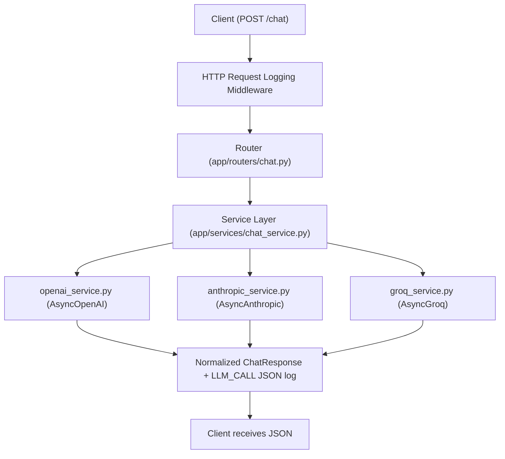

# FDE Sprint LLM Gateway

A unified, async **FastAPI** gateway wrapping **OpenAI**, **Anthropic**, and **Groq** behind a single normalized API contract — complete with a dedicated service layer, deliberate upstream HTTP error mapping, secret redaction, per-request observability, and a 4-level `pytest` suite.

---

## Features

- **Unified Multi-Provider Interface** — Switch between `openai`, `anthropic`, and `groq` on `POST /chat` while always receiving the same normalized JSON schema (`reply`, `model`, `input_tokens`, `output_tokens`, `latency_ms`, `estimated_cost_usd`).
- **Clean Layered Architecture** — Thin HTTP router (`app/routers/chat.py`), provider-dispatching service layer (`app/services/chat_service.py`), and isolated SDK services (`openai_service.py`, `anthropic_service.py`, `groq_service.py`).
- **Centralized Model & Prompt Governance** — Models are controlled via `.env` and the system prompt lives in `app/core/prompts.py` rather than untrusted per-request overrides.
- **Deliberate Error Handling & Secret Redaction** — Maps upstream SDK exceptions to accurate HTTP status codes (`400`, `401`, `403`, `429`, `502`, `503`, `504`), converts unexpected bugs into a consistent `500` JSON envelope, and redacts leaked API keys (`sk-...`, `sk-ant-...`, `gsk_...`, `Bearer ...`).
- **Per-Request Observability** — Colored console logs + single rotating file (`logs/app.log`, 5 MB max, 3 backups) in development, recording every HTTP request (`api.access`) and every LLM call (`LLM_CALL` structured JSON with latency and USD cost estimation).
- **One-Command Workflows via `uv`** — Built-in `dev`, `start`, `test`, `test-live`, and `test-all` scripts configured in `pyproject.toml`.

---

## Architecture



### Project Structure

```text
week1/
├── app/
│   ├── cli.py                       # CLI entry points (dev, start, test, test-live, test-all)
│   ├── config.py                    # Environment-backed Settings dataclass
│   ├── main.py                      # FastAPI app wiring, middleware, /health, / -> /docs
│   ├── core/
│   │   ├── exceptions.py            # Domain exceptions, upstream mapper, secret redaction, handlers
│   │   ├── logging.py               # Colored console + rotating file logging + HTTP middleware
│   │   ├── pricing.py               # Per-1M token model pricing table & USD cost calculator
│   │   └── prompts.py               # Centralized SYSTEM_PROMPT
│   ├── routers/
│   │   └── chat.py                  # Thin POST /chat HTTP endpoint
│   ├── schemas/
│   │   ├── chat.py                  # ChatRequest, ChatResponse, Provider Literal
│   │   └── health.py                # HealthResponse schema
│   └── services/
│       ├── chat_service.py          # Provider selection & orchestration layer
│       ├── openai_service.py        # OpenAI SDK integration
│       ├── anthropic_service.py     # Anthropic SDK integration
│       └── groq_service.py          # Groq SDK integration
├── docs/
│   └── provider-comparison.md       # Side-by-side comparison of OpenAI, Anthropic, and Groq
├── tests/
│   ├── conftest.py                  # Shared TestClient & isolated settings fixtures
│   ├── unit/                        # Level 1: schemas, exceptions, pricing & logging
│   ├── api/                         # Level 2: HTTP router & error contract tests
│   ├── integration/                 # Level 3: mocked OpenAI, Anthropic, and Groq services
│   └── smoke/                       # Level 4: live API smoke tests (@pytest.mark.live)
├── .env.example                     # Environment variable template
├── pyproject.toml                   # Project metadata, dependencies, scripts, pytest config
└── uv.lock                          # Locked dependency graph
```

---

## Setup & Installation

### Prerequisites

- **Python** `>= 3.11`
- **[`uv`](https://docs.astral.sh/uv/)** package & environment manager

### 1. Install dependencies

```powershell
uv sync
```

This creates/updates `.venv`, installs all runtime + dev dependencies, and installs the project CLI scripts (`dev`, `start`, `test`, `test-live`, `test-all`).

### 2. Configure environment variables

Copy `.env.example` to `.env` and fill in at least one provider key (Groq offers a free developer API key at [console.groq.com](https://console.groq.com/keys)):

```powershell
Copy-Item .env.example .env
```

| Variable | Required | Default | Description |
| :--- | :---: | :--- | :--- |
| `OPENAI_API_KEY` | For `openai` | `None` | OpenAI API key |
| `ANTHROPIC_API_KEY` | For `anthropic` | `None` | Anthropic API key |
| `GROQ_API_KEY` | For `groq` | `None` | Groq API key (free tier supported) |
| `OPENAI_MODEL` | No | `gpt-6-luna` | Model ID used for OpenAI calls |
| `ANTHROPIC_MODEL` | No | `claude-haiku-5-5` | Model ID used for Anthropic calls |
| `GROQ_MODEL` | No | `llama-3.3-70b-versatile` | Model ID used for Groq calls (e.g. `openai/gpt-oss-120b`) |
| `REQUEST_TIMEOUT` | No | `30` | Upstream LLM request timeout in seconds |
| `APP_ENV` | No | `development` | `development` enables DEBUG + `logs/app.log`; `production` logs INFO to console only |
| `HOST` | No | `127.0.0.1` (`dev`) / `0.0.0.0` (`start`) | Server bind host |
| `PORT` | No | `8000` | Server bind port |

---

## Running the Server

| Command | Mode | Behavior |
| :--- | :--- | :--- |
| `uv run dev` | Development | Starts Uvicorn on `127.0.0.1:8000` with hot-reload watching `app/` and loads `.env` |
| `uv run start` | Production-style | Starts Uvicorn on `0.0.0.0:8000` without reload and loads `.env` if present |

Once running, open **`http://127.0.0.1:8000`** in your browser — it automatically redirects to the interactive Swagger UI at **`/docs`**.

---

## API Reference

### `GET /health`

Health-check endpoint.

**Response (`200 OK`):**
```json
{
  "status": "ok"
}
```

### `POST /chat`

Send a prompt to the chosen LLM provider (`"openai"`, `"anthropic"`, or `"groq"`). Defaults to `"openai"` when `provider` is omitted. Maximum message length is `10,000` characters.

**Request:**
```json
{
  "message": "Explain idempotency in REST APIs in two sentences.",
  "provider": "groq"
}
```

**Response (`200 OK`):**
```json
{
  "provider": "groq",
  "model": "openai/gpt-oss-120b",
  "reply": "Idempotency means that making the same REST request multiple times produces the same server state as making it once...",
  "input_tokens": 95,
  "output_tokens": 40,
  "latency_ms": 604.45,
  "estimated_cost_usd": 0.00003825
}
```

**PowerShell example:**
```powershell
$body = @{ message = "Explain FastAPI in one sentence."; provider = "groq" } | ConvertTo-Json
Invoke-RestMethod -Uri "http://127.0.0.1:8000/chat" -Method Post -ContentType "application/json" -Body $body
```

**`curl` example:**
```bash
curl -X POST http://127.0.0.1:8000/chat \
  -H "Content-Type: application/json" \
  -d '{"message": "Explain FastAPI in one sentence.", "provider": "groq"}'
```

### Error Format & Status Mapping

All application and unexpected errors return a consistent JSON structure with any accidental API key tokens redacted as `[REDACTED]`:

```json
{
  "error": "llm_provider_error",
  "provider": "groq",
  "detail": "Groq request timed out."
}
```

| HTTP Status | Trigger | `error` Code |
| :---: | :--- | :--- |
| `400` | Upstream `BadRequestError` (invalid params / context limit) | `llm_provider_error` |
| `401` | Upstream `AuthenticationError` (invalid/expired API key) | `llm_provider_error` |
| `403` | Upstream `PermissionDeniedError` | `llm_provider_error` |
| `422` | Invalid request schema (FastAPI) or `StructuredOutputValidationError` | Validation / `structured_output_validation_error` |
| `429` | Upstream `RateLimitError` (RPM/TPM/quota exceeded) | `llm_provider_error` |
| `500` | Unhandled internal exception (logged with full traceback server-side) | `internal_error` |
| `502` | Upstream 5xx, network drop (`APIConnectionError`), or empty reply | `llm_provider_error` |
| `503` | Provider API key is not configured in `.env` | `llm_provider_error` |
| `504` | Upstream `APITimeoutError` / `TimeoutError` | `llm_provider_error` |

---

## Observability & Logging

Logging is initialized at the top of `app/main.py` via `setup_logging()` before other application modules load:

- **Console:** Color-coded severity levels (`DEBUG` cyan, `INFO` green, `WARNING` yellow, `ERROR` red, `CRITICAL` magenta).
- **File (development only):** Single rotating log file at `logs/app.log` (5 MB max, 3 backups, plain text with no ANSI escape codes).
- **HTTP Middleware (`api.access`):** Logs every endpoint call with method, path, status code, and latency:
  ```text
  2026-11-18 00:48:44 | INFO | api.access | POST /chat -> 200 (723.56 ms)
  ```
- **LLM Telemetry (`llm_observability`):** Emits structured JSON on every provider call (both successes and failures) with estimated USD cost computed from `app/core/pricing.py`:
  ```text
  2026-11-18 00:48:44 | INFO | llm_observability | LLM_CALL {"timestamp": "...", "provider": "groq", "model": "openai/gpt-oss-120b", "latency_ms": 721.52, "input_tokens": 160, "output_tokens": 33, "estimated_cost_usd": 4.38e-05, "status": "success", "error": null}
  ```

---

## Testing

The test suite is organized into four levels under `tests/`:

| Folder | Level | What It Tests |
| :--- | :---: | :--- |
| `tests/unit/` | 1 — Unit | Schemas, exceptions, secret redaction, cost calculation, and logging setup |
| `tests/api/` | 2 — Router / API | `/health`, `/`, `/chat` routing, validation (`422`), and error envelopes via `TestClient` |
| `tests/integration/` | 3 — Provider | Mocked `AsyncOpenAI`, `AsyncAnthropic`, and `AsyncGroq` SDK calls & status mappings |
| `tests/smoke/` | 4 — Live Smoke | Real API calls (`@pytest.mark.live`); auto-skips providers without live keys in `.env` |

### Test Commands

| Command | Scope |
| :--- | :--- |
| `uv run test` | Runs all automated tests (**excludes** live smoke tests) |
| `uv run test-live` | Runs **only** live API smoke tests (`tests/smoke`) |
| `uv run test-all` | Runs **everything**, including live API smoke tests |

You can also target a single folder or keyword:

```powershell
uv run test tests/unit
uv run test tests/api
uv run test tests/integration
uv run test -k "rate_limit"
```

---

## Documentation

- **[Provider Comparison (`docs/provider-comparison.md`)](docs/provider-comparison.md)** — Detailed comparison of OpenAI, Anthropic, and Groq covering SDKs, API styles, pricing, context windows, rate limits, data retention policies, live Groq latency measurements, and provider selection guidelines.
