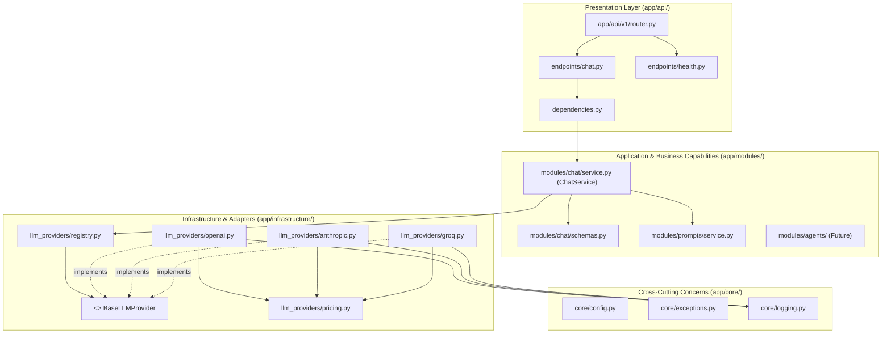

# FDE Sprint LLM Gateway

A modular, production-ready **FastAPI** gateway wrapping **OpenAI**, **Anthropic**, and **Groq** behind a single normalized contract. Built with **Clean Architecture** separation of concerns, Dependency Inversion, per-request observability, deliberate HTTP status mapping, secret redaction, and a 4-level `pytest` suite.

---

## Features

- **Unified Multi-Provider Gateway** — Route seamlessly across `openai`, `anthropic`, and `groq` via `POST /v1/chat`, receiving normalized responses (`reply`, `model`, `input_tokens`, `output_tokens`, `latency_ms`, `estimated_cost_usd`).
- **Clean Architecture & Dependency Inversion** — Presentation layer (`app/api/`), application domain capabilities (`app/modules/`), provider adapters (`app/infrastructure/`), and cross-cutting concerns (`app/core/`).
- **Extensible Provider Registry** — Adapters implement `BaseLLMProvider` and register via `LLMProviderRegistry`, allowing new providers (e.g. Mistral, Bedrock, Cohere) without touching chat business logic.
- **Dedicated Prompt Management** — `PromptService` loads system prompt templates from `templates/` with caching and fallback support.
- **Deliberate Error Handling & Secret Redaction** — Maps upstream SDK exceptions to standard HTTP status codes (`400`, `401`, `403`, `429`, `502`, `503`, `504`), converts unexpected exceptions to clean JSON envelopes, and redacts sensitive API keys (`sk-...`, `sk-ant-...`, `gsk_...`, `Bearer ...`).
- **Production Observability** — Color-coded console logs + single rotating log file (`logs/app.log`, 5 MB max, 3 backups), tracking HTTP access logs and structured JSON `LLM_CALL` records with per-model USD cost calculation.
- **Developer-Friendly CLI Commands** — Custom scripts defined in `pyproject.toml`: `dev`, `start`, `test`, `test-live`, and `test-all`.

---

## Architecture & Dependency Direction

The codebase strictly follows Clean Architecture principles: **The application defines what it needs; infrastructure implements it.**



### Directory Structure & Responsibilities

```text
fde-llm-gateway/
├── app/
│   ├── api/                         # Presentation Layer (FastAPI controllers & routes)
│   │   └── v1/
│   │       ├── endpoints/
│   │       │   ├── chat.py          # POST /chat and POST /v1/chat
│   │       │   └── health.py        # GET /health and GET /v1/health
│   │       ├── router.py            # Aggregates endpoints under api_v1_router
│   │       └── dependencies.py      # Dependency injection providers (get_chat_service)
│   ├── modules/                     # Application & Business Capabilities
│   │   ├── chat/
│   │   │   ├── schemas.py           # ChatRequest, ChatResponse, Provider literal
│   │   │   ├── service.py           # ChatService orchestration & provider dispatch
│   │   │   └── exceptions.py        # Domain chat exceptions (UnsupportedProviderError)
│   │   ├── prompts/
│   │   │   ├── schemas.py           # PromptTemplate models
│   │   │   ├── service.py           # PromptService with dynamic versioned template loading
│   │   │   └── templates/           # Versioned prompt library
│   │   │       ├── default.txt      # System prompt template
│   │   │       └── customer_support/ # Customer support versioned prompt suite
│   │   │           ├── v1.txt       # V1 Basic prompt
│   │   │           ├── v2.txt       # V2 Detailed instructions with JSON schema
│   │   │           └── v3.txt       # V3 Detailed instructions + few-shot examples
│   │   └── agents/                  # Future agent workflows & tool orchestration
│   ├── infrastructure/              # External Integrations & Adapters
│   │   ├── llm_providers/
│   │   │   ├── base.py              # BaseLLMProvider abstract interface
│   │   │   ├── openai.py            # OpenAI AsyncOpenAI adapter
│   │   │   ├── anthropic.py         # Anthropic AsyncAnthropic adapter
│   │   │   ├── groq.py              # Groq AsyncGroq adapter
│   │   │   ├── pricing.py           # Provider pricing table & USD cost calculator
│   │   │   └── registry.py          # LLMProviderRegistry (inversion of control)
│   │   ├── observability/           # Logging & metrics adapters
│   │   └── persistence/             # Future database & session storage adapters
│   ├── core/                        # Cross-Cutting Concerns
│   │   ├── config.py                # Environment Settings dataclass
│   │   ├── exceptions.py            # AppBaseException, LLMProviderError, secret redactor
│   │   └── logging.py               # Rotating file, colored formatter, request middleware
│   ├── cli.py                       # CLI command implementations (dev, start, test, experiments)
│   └── main.py                      # Application bootstrap, middleware & route mounting
├── docs/
│   ├── promt-experiment/            # Prompt engineering evaluation suite
│   │   ├── prompt-experiments.md    # 30-run benchmark analysis & evaluation report
│   │   └── prompt_experiments_data.json # Raw benchmark execution dataset
│   ├── day-logs/                    # Daily development logs
│   └── provider-comparison.md       # Full comparison matrix of OpenAI, Anthropic, and Groq
├── scripts/                         # Standalone runner & analysis scripts
│   ├── run_prompt_experiments.py    # 30-run benchmark runner against live Groq LLM
│   └── analyze_results.py           # Metric calculator & per-ticket comparison formatter
├── tests/
│   ├── conftest.py                  # Shared TestClient & isolated settings fixtures
│   ├── unit/                        # Schemas, exceptions, prompt service, registry, pricing
│   ├── api/                         # Endpoints (/health, /docs, /chat, /v1/chat, validation)
│   ├── integration/                 # Mocked provider adapters (OpenAI, Anthropic, Groq)
│   └── smoke/                       # Live API smoke tests (@pytest.mark.live)
├── pyproject.toml                   # Project metadata, dependencies, scripts, pytest config
├── uv.lock                          # Locked dependency tree
├── .env.example                     # Environment template
└── README.md
```

---

## Setup & Installation

### Prerequisites

- **Python** `>= 3.11`
- **[`uv`](https://docs.astral.sh/uv/)** package and project manager

### 1. Install dependencies

```powershell
uv sync
```

This installs all dependencies and binds the custom CLI scripts (`dev`, `start`, `test`, `test-live`, `test-all`).

### 2. Configure environment variables

Copy `.env.example` to `.env` and fill in your API key(s):

```powershell
Copy-Item .env.example .env
```

| Variable | Required | Default | Description |
| :--- | :---: | :--- | :--- |
| `OPENAI_API_KEY` | For `openai` | `None` | OpenAI API key |
| `ANTHROPIC_API_KEY` | For `anthropic` | `None` | Anthropic API key |
| `GROQ_API_KEY` | For `groq` | `None` | Groq API key (free tier supported at [console.groq.com](https://console.groq.com/keys)) |
| `OPENAI_MODEL` | No | `gpt-6-luna` | Default OpenAI model |
| `ANTHROPIC_MODEL` | No | `claude-haiku-5-5` | Default Anthropic model |
| `GROQ_MODEL` | No | `llama-3.3-70b-versatile` | Default Groq model |
| `REQUEST_TIMEOUT` | No | `30` | Upstream LLM request timeout (seconds) |
| `APP_ENV` | No | `development` | `development` enables DEBUG + `logs/app.log`; `production` logs INFO to console |
| `HOST` | No | `127.0.0.1` (`dev`) / `0.0.0.0` (`start`) | Server host |
| `PORT` | No | `8000` | Server port |

---

## Running the Server

| Command | Mode | Description |
| :--- | :--- | :--- |
| `uv run dev` | Development | Runs Uvicorn on `127.0.0.1:8000` with hot-reload watching `app/` and loads `.env` |
| `uv run start` | Production | Runs Uvicorn on `0.0.0.0:8000` without reload |

Once running, visit **`http://127.0.0.1:8000`** in your browser — it automatically redirects to the interactive Swagger UI at **`/docs`**.

---

## API Reference

### Health Check

- `GET /v1/health`

**Response (`200 OK`):**
```json
{
  "status": "ok"
}
```

### Chat Completion

- `POST /v1/chat`

Supports optional `prompt_version` to dynamically select versioned system prompts (e.g. `'v1'`, `'v2'`, `'v3'`, or `'customer_support/v2'`). If omitted, the default system prompt is used.

**Request:**
```json
{
  "message": "My order #12345 arrived damaged, please refund me.",
  "provider": "groq",
  "prompt_version": "v2"
}
```

**Response (`200 OK`):**
```json
{
  "provider": "groq",
  "model": "openai/gpt-oss-120b",
  "reply": "{\n  \"category\": \"Billing & Payments\",\n  \"urgency\": \"High\",\n  \"sentiment\": \"Frustrated\",\n  \"churn_risk\": false,\n  \"key_entities\": [\"#12345\"],\n  \"summary\": \"Customer requests a refund for damaged order #12345.\",\n  \"recommended_action\": \"Review order #12345 and initiate replacement or refund procedure.\"\n}",
  "input_tokens": 583,
  "output_tokens": 78,
  "latency_ms": 1535.14,
  "estimated_cost_usd": 0.00029595,
  "prompt_version": "customer_support/v2"
}
```

### List Available Prompts

- `GET /v1/chat/prompts` (or `GET /v1/prompts`)

Discover available prompt categories and versions for testing without looking at the filesystem.

**Response (`200 OK`):**
```json
{
  "default_category": "customer_support",
  "available_customer_support_versions": ["v1", "v2", "v3"],
  "all_categories": {
    "customer_support": ["v1", "v2", "v3"]
  },
  "usage_example": {
    "message": "My order #12345 arrived damaged, please refund me.",
    "provider": "groq",
    "prompt_version": "v2"
  }
}
```

**PowerShell example:**
```powershell
$body = @{ message = "Explain FastAPI in one sentence."; provider = "groq" } | ConvertTo-Json
Invoke-RestMethod -Uri "http://127.0.0.1:8000/v1/chat" -Method Post -ContentType "application/json" -Body $body
```

**`curl` example:**
```bash
curl -X POST http://127.0.0.1:8000/v1/chat \
  -H "Content-Type: application/json" \
  -d '{"message": "Explain FastAPI in one sentence.", "provider": "groq"}'
```

### Error Handling & Status Codes

All errors return a consistent JSON schema with leaked API keys redacted:

```json
{
  "error": "llm_provider_error",
  "provider": "groq",
  "detail": "Groq request timed out."
}
```

| HTTP Status | Trigger | Code |
| :---: | :--- | :--- |
| `400` | Upstream `BadRequestError` / Invalid provider | `llm_provider_error` / `unsupported_provider` |
| `401` | Upstream `AuthenticationError` (invalid key) | `llm_provider_error` |
| `403` | Upstream `PermissionDeniedError` | `llm_provider_error` |
| `422` | Request validation failed or output schema mismatch | `validation_error` / `structured_output_validation_error` |
| `429` | Upstream `RateLimitError` (rate limit or quota) | `llm_provider_error` |
| `500` | Unhandled internal server error | `internal_error` |
| `502` | Upstream connection dropped, DNS failed, or empty choices | `llm_provider_error` |
| `503` | Provider API key missing from environment | `llm_provider_error` |
| `504` | Upstream `APITimeoutError` / `TimeoutError` | `llm_provider_error` |

---

## Testing

Tests are organized into 4 architectural levels:

| Level | Folder | Scope | Count |
| :---: | :--- | :--- | :---: |
| **1** | `tests/unit/` | Schemas, exceptions, versioned prompt library, registry, pricing, logging | 31 |
| **2** | `tests/api/` | FastAPI endpoints (`/v1/health`, `/v1/chat`, prompt versioning, validation) | 17 |
| **3** | `tests/integration/` | Mocked OpenAI, Anthropic, and Groq adapters & exception mapping | 21 |
| **4** | `tests/smoke/` | Real API calls (`@pytest.mark.live`); skips unconfigured keys | 3 |

### Test Commands

| Command | Description |
| :--- | :--- |
| `uv run test` | Runs all automated tests (79 tests, **excludes** live network calls) |
| `uv run test-live` | Runs **only** live API smoke tests (`tests/smoke`) |
| `uv run test-all` | Runs **every** test (82 tests including live smoke tests) |

Target a specific module or test keyword:
```powershell
uv run test tests/unit
uv run test tests/api
uv run test tests/integration
uv run test -k "rate_limit"
```

---

## Prompt Engineering & Experiments

Commands to run and analyze the 3-version customer-support prompt benchmark:

| Command | Description |
| :--- | :--- |
| `uv run run-experiments` | Executes 30 live benchmark runs (10 identical tickets x V1, V2, V3) on Groq |
| `uv run analyze-experiments` | Parses `docs/promt-experiment/prompt_experiments_data.json` and prints aggregate + per-ticket comparative analysis |

Alternatively, run via Python directly:
```powershell
uv run python scripts/run_prompt_experiments.py
uv run python scripts/analyze_results.py
```

---

## Documentation

- **[Prompt Engineering Experiments (`docs/promt-experiment/prompt-experiments.md`)](docs/promt-experiment/prompt-experiments.md)** — In-depth evaluation of 3 prompt versions (V1 Basic, V2 Detailed, V3 Few-shot) across 10 benchmark customer support tickets (30 live runs evaluated for correctness, consistency, hallucination, output quality, latency, and token cost).
- **[Provider Comparison (`docs/provider-comparison.md`)](docs/provider-comparison.md)** — Comprehensive comparison of OpenAI, Anthropic, and Groq across SDKs, pricing, context windows, rate limits, data retention policies, measured latency, and decision matrix.
