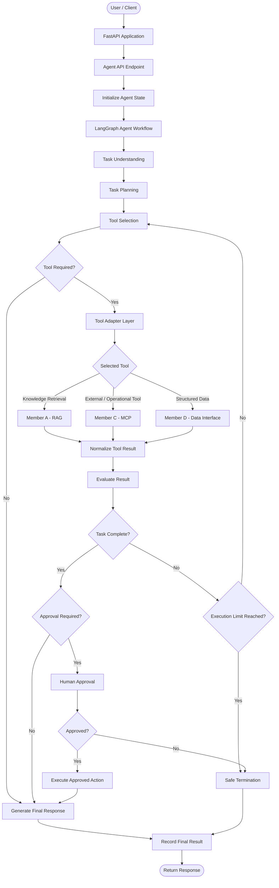
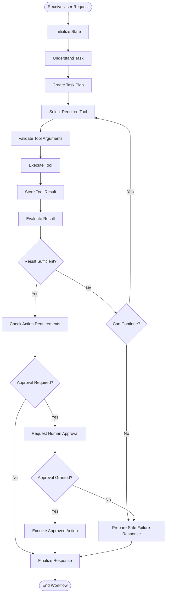
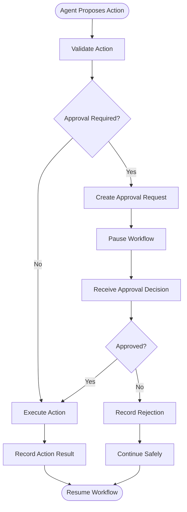
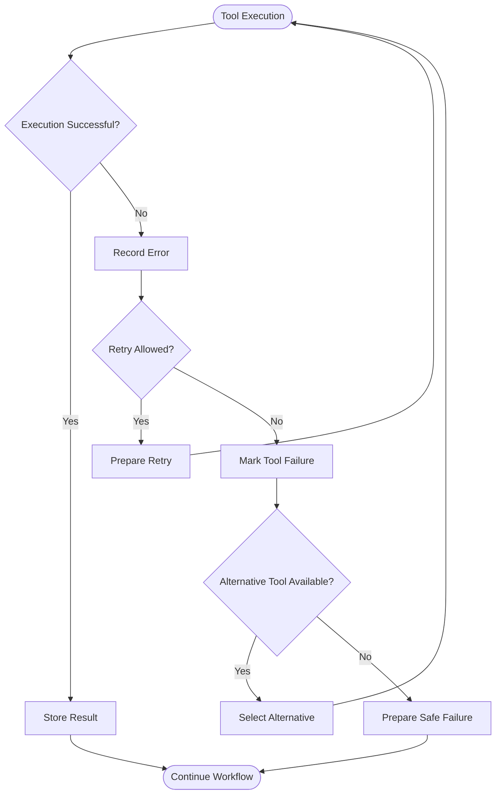

# AI Agent Design Document
## Shared Customer-Support & Operations Assistant

## 1. Project Overview

The shared capstone project is a customer-support or operations assistant designed to combine data engineering, knowledge retrieval, AI agent orchestration, external tools, evaluation, and security into a single integrated application.

The system will process messy customer or operational data, retrieve relevant knowledge, use AI-driven workflows to complete tasks, interact with external capabilities through the Model Context Protocol (MCP), and operate within a secured, Dockerized environment deployed on AWS.

The AI Agent component is responsible for coordinating these capabilities and converting user requests into structured, controlled, and traceable workflows.

The agent will not independently implement the data pipeline, retrieval system, or MCP tools. Instead, it will consume the capabilities provided by the other components through defined interfaces.

## 2. Project Objectives

The primary objective is to build a stateful AI agent capable of completing a controlled customer-support or operations workflow.

The agent should be able to:

- Understand user requests and identify the desired outcome.
- Determine the steps required to complete a task.
- Retrieve relevant knowledge from the RAG component.
- Select and invoke available tools through a common tool interface.
- Interact with MCP tools provided by the shared system.
- Maintain workflow state throughout execution.
- Evaluate tool results and determine whether additional steps are required.
- Handle tool failures, retries, and invalid responses.
- Enforce execution limits to prevent uncontrolled loops.
- Request human approval before consequential actions.
- Produce a final response containing the result of the workflow.
- Maintain execution logs and traces for debugging and evaluation.
- Integrate with other team components without depending on their internal implementation.

## 3. Agent Scope

### 3.1 Included in the Agent

The agent component will include:

- Stateful workflow orchestration using LangGraph.
- Task understanding and workflow routing.
- Tool selection and invocation.
- Tool registration and adapter layer.
- RAG integration.
- MCP tool integration.
- Workflow state management.
- Conditional graph execution.
- Result evaluation and decision-making.
- Bounded retries and execution limits.
- Tool-error recovery.
- Human approval workflow.
- Execution logging and tracing.
- Checkpointing and resumable execution where required.
- Agent-level unit and integration tests.
- Integration with the shared FastAPI backend.

### 3.2 Not Included in the Agent

The following responsibilities belong to other components or are outside the initial scope:

- Building the data-cleaning and data-engineering pipeline.
- Implementing document ingestion, chunking, and embedding generation.
- Implementing the vector database or retrieval-ranking system.
- Rebuilding Member A's RAG functionality.
- Implementing Member C's MCP servers and individual tools.
- Reimplementing Member D's data-processing logic.
- Building a general-purpose autonomous agent for arbitrary tasks.
- Developing a complex multi-agent architecture.
- Giving the agent unrestricted database, shell, or external API access.
- Allowing unrestricted autonomous execution of consequential actions.
- Building a separate frontend solely for the agent.
- Implementing long-term conversational memory unless required by the agreed capstone workflow.
- Replacing the existing FastAPI backend or provider services.

The initial implementation will focus on one reliable end-to-end workflow rather than supporting every possible customer-support scenario.

## 4. Proposed Technology Stack

| Component | Technology | Responsibility |
|---|---|---|
| Backend API | Existing FastAPI application | Request handling and API exposure |
| Agent Framework | LangGraph | Stateful workflow orchestration |
| LLM Integration | Existing provider services | Task interpretation, reasoning, and response generation |
| Retrieval Integration | Member A's RAG component | Knowledge retrieval |
| Tool Integration | MCP / Member C's tools | External and operational capabilities |
| State Management | LangGraph state | Workflow progress and intermediate results |
| Persistence | Existing database or checkpoint store | Execution state and history |
| Background Processing | Redis/SQS or agreed worker infrastructure | Long-running execution and retries |
| Logging | Existing application logging | Execution events and errors |
| Deployment | Docker and AWS | Containerized deployment |

The agent should reuse the existing backend architecture and avoid introducing unnecessary infrastructure.

### 4.1 Framework Selection: LangGraph vs LangChain vs CrewAI

| Criterion | LangGraph (Selected) | LangChain (Legacy Chains / AgentExecutor) | CrewAI |
|---|---|---|---|
| **Control & Determinism** | Explicit nodes, typed `AgentState`, and deterministic conditional edges | Opaque `AgentExecutor` loop; hard to customize mid-loop limits | Role-based multi-agent abstractions hide low-level routing |
| **Loop & Safety Bounds** | Central `max_tool_calls` and `recursion_limit` enforced in graph edges | Relies heavily on prompt/max_iterations heuristics | Extra inter-agent coordination overhead |
| **Human-in-the-Loop & Checkpointing** | First-class interrupt/resume and state persistence | Limited native checkpointing | Not designed around single-graph stateful interrupts |
| **Fit for Single-Agent Support Workflow** | Ideal for one controlled customer-support & operations workflow | Legacy pattern; LangGraph is the modern successor | Overkill for a single orchestrator coordinating RAG + tools |

**Decision:** Use **LangGraph (`StateGraph`)** so the graph owns the tool-calling loop, state transitions, execution bounds, and future approval interrupts, while reusing existing FastAPI, provider clients, `PromptService`, and `RAGService`.

## 5. High-Level Architecture

The agent will operate as a modular orchestration component within the existing backend.

### 5.1 Architecture Diagram



### 5.2 Architectural Responsibilities

#### FastAPI Application

The API layer will:

- Receive agent requests.
- Validate request payloads.
- Apply authentication and authorization.
- Create or identify the task execution.
- Start the agent workflow.
- Return the final result or execution status.

The API layer should not contain the agent's internal decision-making logic.

#### LangGraph Agent Workflow

The orchestration layer will:

- Manage the graph and execution flow.
- Maintain workflow state.
- Route between nodes.
- Decide when tools are required.
- Evaluate tool results.
- Control retries and execution limits.
- Handle approval and recovery paths.

#### Tool Adapter Layer

The adapter layer will:

- Provide a consistent interface for tool invocation.
- Register or discover available tools.
- Validate tool inputs.
- Normalize tool outputs.
- Handle tool-specific errors.
- Keep the agent independent of individual tool implementations.

#### State and Persistence Layer

The state layer will:

- Track task progress.
- Store intermediate results.
- Track tool calls and errors.
- Maintain approval status.
- Support checkpointing and resumption where required.
- Provide execution history for debugging and evaluation.

## 6. Agent Workflow Design

The agent will use a graph-based workflow with explicit nodes and conditional transitions.

### 6.1 Graph Nodes

| Node | Responsibility |
|---|---|
| `understand_task` | Interpret the request and identify the intended outcome |
| `plan_task` | Determine the steps required to complete the task |
| `select_tool` | Select the appropriate retrieval or MCP tool |
| `execute_tool` | Invoke the selected tool |
| `evaluate_result` | Determine whether the result is sufficient |
| `request_approval` | Pause execution for approval when required |
| `execute_approved_action` | Execute an approved consequential action |
| `handle_error` | Process tool and workflow failures |
| `finalize_response` | Generate the final response |
| `end` | Terminate the workflow |

The implementation may combine nodes where appropriate, but the responsibilities should remain clearly separated.

### 6.2 Main Workflow



### 6.3 Conditional Routing

The graph should support the following routing decisions:

- If knowledge is required, invoke the retrieval tool.
- If structured information is required, invoke the appropriate data or MCP tool.
- If the tool succeeds, evaluate its result.
- If the result is insufficient, continue with another permitted step.
- If a tool fails, enter the recovery path.
- If an action requires approval, pause execution.
- If approval is denied, do not execute the action.
- If execution limits are reached, terminate safely.
- If the task cannot be completed, return a controlled failure response.

The graph must not depend on the LLM alone to enforce execution limits.

## 7. Agent State Design

The agent requires a shared state object that is passed between graph nodes.

### 7.1 Proposed State Schema

```python
class AgentState(TypedDict):
    task_id: str
    user_request: str
    provider: str
    model: str
    system_prompt: str
    messages: list[dict[str, Any]]
    tool_calls: list[dict[str, Any]]
    tool_results: list[dict[str, Any]]
    tool_call_count: int
    max_tool_calls: int
    execution_status: Literal["pending", "running", "completed", "limit_reached", "failed"]
    errors: list[str]
    final_result: str | None
    prompt_tokens: int
    completion_tokens: int
    trace: list[dict[str, Any]]
```

This schema is implemented in `app/modules/agents/state.py` (`AgentState` and `create_initial_state`) alongside Pydantic tool argument/response models in `app/modules/agents/schemas.py`.

### 7.2 State Management Rules

- State must be explicit and predictable.
- Nodes should update only the fields required for their operation.
- Tool results must be stored in a normalized structure.
- Sensitive information must not be unnecessarily copied into state.
- Retry counters and execution limits must be enforced centrally.
- State should support execution tracing and debugging.
- Checkpointing should be used when workflow interruption or resumption is required.

### 7.3 Workflow State and Memory

Workflow state and long-term memory are separate concepts.

Workflow state stores information required to complete the current task.

Long-term memory stores selected information that may be useful across multiple tasks or conversations.

The initial implementation will prioritize workflow state. Persistent memory will only be introduced if it is necessary for the agreed use case.

## 8. Tool Integration Design

The agent must consume tools through a consistent interface.

This is essential because the other team members may change their implementations during development.

### 8.1 Tool Adapter Layer

The agent should not directly depend on individual tool implementations.

The adapter layer should provide a common execution contract:

```python
class AgentTool:
    name: str
    description: str
    input_schema: dict

    async def execute(self, arguments: dict) -> dict:
        ...
```

This is a conceptual interface. The actual implementation may use LangChain tool abstractions, MCP clients, or custom adapters.

The adapter layer should handle:

- Tool registration.
- Tool descriptions.
- Input validation.
- Tool invocation.
- Output normalization.
- Timeouts.
- Error handling.
- Permission checks.

### 8.2 Member A — RAG Integration

The agent will consume Member A's retrieval capability.

Expected input:

- Retrieval query.
- Optional retrieval parameters such as top-k or filters.

Expected output:

- Relevant retrieved content.
- Source references or citations.
- Retrieval metadata where available.

The agent must not depend on:

- Embedding model implementation.
- Vector database implementation.
- Chunking strategy.
- Internal retrieval ranking logic.

Member A's implementation should be replaceable as long as the agreed retrieval interface remains compatible.

### 8.3 Member C — MCP Integration

The agent will use MCP tools to access external or operational capabilities.

The integration should support:

- Tool discovery or registration.
- Tool descriptions.
- Input schemas.
- Tool invocation.
- Structured results.
- Error responses.
- Execution timeouts.

The agent should not hardcode the internal logic of MCP tools into the graph.

The available tools should be registered or discovered through a defined mechanism.

### 8.4 Member D — Data Integration

The agent will consume capabilities exposed by the data pipeline or retrieval system.

Possible capabilities include:

- Customer information lookup.
- Operational data retrieval.
- Structured record access.
- Data quality information.

The exact integration path must be agreed with Members A and D.

The agent should not assume direct access to Member D's internal database or data-cleaning pipeline.

### 8.5 Interface Contract

Each integrated component defines explicit schemas and error boundaries:

| Integration Boundary | Input Contract | Output Contract | Error / Timeout Behavior |
|---|---|---|---|
| **FastAPI (`/v1/chat/tools`)** | `AgentChatRequest(message, provider)` | `AgentChatResponse(reply, provider, model, tool_calls, total_latency_ms, estimated_cost_usd)` | Maps `LLMProviderError` / `StructuredOutputValidationError` via `app_exception_handler` |
| **Order Lookup (`get_order_status`)** | `OrderStatusArgs(order_id: str)` | `OrderDetails(order_id, status, carrier, tracking_number, estimated_delivery, items, total_usd)` | Unknown ID returns `status="NotFound"`; invalid args raise `StructuredOutputValidationError` (422) |
| **Member A — RAG (`search_knowledge`)** | `SearchKnowledgeArgs(query, top_k, strategy)` -> `RAGRequest` | Normalized dict `{query, answer, is_grounded, citations, retrieval_strategy, sources}` | Grounded fallback (`is_grounded=False`) or structured error payload in `tool_node` |
| **Member C — MCP Tools (Planned)** | JSON Schema validated arguments | Normalized dict `{status, data, metadata}` | Enforced `tool_timeout_seconds` (15s) and bounded retries |
| **Member D — Data Interface (Planned)** | Typed customer/record lookup key | Normalized structured record | Read-only scoped access; no raw SQL exposed to LLM |

The agent uses mock implementations (`MOCK_ORDERS`) during development where external MCP/data interfaces are not yet available.

## 9. Human Approval and Action Safety

The agent must distinguish between retrieving information and performing consequential actions.

### 9.1 Action Categories

#### Read-Only Actions

Examples:

- Search knowledge.
- Retrieve policy information.
- Look up authorized customer or operational records.
- Summarize information.

These actions may execute automatically when the user is authorized.

#### Low-Risk Actions

Examples:

- Prepare a support response.
- Draft a resolution.
- Generate a report.
- Create a proposed operational plan.

These actions may execute automatically according to application policy.

#### Consequential Actions

Examples:

- Issue a refund.
- Modify a customer record.
- Cancel an order.
- Send an external message.
- Perform an operation with financial or business impact.

These actions must require explicit authorization or human approval according to the application's policy.

### 9.2 Approval Workflow



Approval must apply only to the specific proposed action and its parameters.

## 10. Error Handling and Recovery

The agent must handle failures without crashing or entering uncontrolled loops.

### 10.1 Failure Scenarios

| Failure | Expected Behavior |
|---|---|
| Tool returns an error | Record the error and evaluate retry |
| Tool times out | Apply timeout and recovery policy |
| Tool returns invalid data | Validate and reject malformed output |
| Retrieval returns no relevant results | Return insufficient information or attempt a permitted alternative |
| LLM provider fails | Apply bounded retry or return controlled failure |
| Tool repeatedly fails | Stop after the configured retry limit |
| Workflow reaches execution limit | Terminate safely |
| Approval is denied | Do not execute the proposed action |
| Approval request expires | Mark task as awaiting review or terminate safely |
| Agent cannot complete the task | Explain the limitation and return available results |

### 10.2 Execution Limits

The agent should enforce configurable limits for:

- Maximum graph steps.
- Maximum tool calls.
- Maximum retries per tool.
- Tool execution timeout.
- Total task execution time.
- Maximum model or token usage where practical.

These limits should be enforced by the orchestration layer.

### 10.3 Recovery Flow



Retries must be bounded. Actions that may have side effects should not be blindly retried without checking whether the previous execution succeeded.

## 11. Logging, Tracing, and Auditability

The agent should produce structured execution records.

Important events include:

- Task creation.
- Task understanding.
- Tool selection.
- Tool invocation.
- Tool result.
- Retry or recovery.
- Approval request.
- Approval decision.
- Final response.
- Workflow failure.

Each execution should be associated with a unique task identifier.

Logs should provide sufficient information to reconstruct the workflow without unnecessarily storing sensitive user data, credentials, or unrestricted conversation content.

The system should distinguish between:

- Application logs.
- Agent execution traces.
- Security and audit events.
- Evaluation results.

## 12. Security and Permissions

The agent must operate within the permissions of the authenticated user and the application.

Security requirements include:

- Authentication before protected agent operations.
- Authorization checks before tool execution.
- Least-privilege tool access.
- Input validation.
- Tool argument validation.
- Protection against prompt injection.
- Separation of user instructions from retrieved or tool-provided content.
- No unrestricted database or shell access.
- No direct exposure of secrets to the LLM.
- Approval requirements for consequential actions.
- Safe handling of sensitive information in logs.

Retrieved documents and tool outputs must be treated as data, not as trusted instructions that can override system policies.

## 13. Testing Strategy

The agent will be tested at multiple levels.

### 13.1 Unit Tests

Test individual graph nodes and helper functions.

Examples:

- Task interpretation.
- Tool selection.
- State updates.
- Tool argument validation.
- Conditional routing.
- Retry-limit enforcement.
- Approval routing.

### 13.2 Integration Tests

Test interactions between:

- FastAPI and the agent workflow.
- Agent and retrieval service.
- Agent and MCP tools.
- Agent and checkpoint storage.
- Agent and approval mechanism.

### 13.3 Failure and Safety Tests

Test:

- Invalid user requests.
- Tool timeouts.
- Tool errors.
- Malformed tool responses.
- Empty retrieval results.
- Prompt injection attempts.
- Excessive tool-call loops.
- Unauthorized actions.
- Denied approval.
- Interrupted workflow execution.

### 13.4 End-to-End Test

The initial end-to-end workflow should demonstrate a customer-support or operations task that:

1. Receives a user request.
2. Retrieves relevant knowledge.
3. Uses at least one additional tool where appropriate.
4. Evaluates the result.
5. Produces a final response.
6. Records the execution trace.

The workflow should be reproducible and suitable for the sprint demonstration.

## 14. Seven-Day Agent Development Plan

The agent implementation will be developed across Days 6–12.

### Day 6 — Architecture and Design

**Objective:** Finalize the agent's scope, architecture, workflow, and integration boundaries.

Activities:

- Define the agent's use case and initial scope.
- Identify responsibilities owned by Member B.
- Compare LangGraph, LangChain, and CrewAI.
- Select the orchestration framework.
- Design graph nodes and conditional edges.
- Draft the agent state schema.
- Define tool adapter responsibilities.
- Identify integration requirements for Members A, C, and D.
- Define approval-required actions.
- Identify execution limits and recovery requirements.
- Document success metrics and risks.
- Prepare the architecture diagram.
- Complete peer review and refine the design.
- Complete the shared n8n fundamentals and simple trigger-to-AI-to-output workflow.

Deliverables:

- Agent design document.
- Architecture diagram.
- Graph workflow design.
- State schema.
- Initial integration contracts.
- Success metrics.
- Risk register.
- Five-day implementation plan for the core agent.

### Day 7 — Core LangGraph Implementation

**Objective:** Build the initial working agent graph.

Activities:

- Set up the LangGraph workflow.
- Define the initial state structure.
- Implement task understanding.
- Implement basic task planning or routing.
- Register two or three initial tools.
- Implement tool selection and invocation.
- Connect the graph to the existing FastAPI backend.
- Use mock tools where team interfaces are not ready.
- Run the workflow end-to-end.
- Add basic execution logging.

Deliverables:

- Working LangGraph graph.
- Initial state management.
- Two or three usable tools.
- FastAPI integration.
- Initial execution trace.

### Day 8 — End-to-End Agent Workflow

**Objective:** Demonstrate that the agent can complete one task from beginning to end.

Activities:

- Refine the graph's conditional routing.
- Connect the retrieval capability where available.
- Implement result evaluation.
- Support multiple tool calls when required.
- Ensure tool results are passed correctly between nodes.
- Implement final response generation.
- Test a customer-support or operations scenario.
- Record the workflow execution.
- Identify and document failure cases.

Deliverables:

- End-to-end agent workflow.
- Demonstration of one completed task.
- Execution trace.
- Initial test cases.
- Known issues and improvement list.

### Day 9 — Reliability, Approval, and Recovery

**Objective:** Make the agent controlled and reliable.

Activities:

- Implement maximum graph-step limits.
- Implement maximum tool-call limits.
- Add bounded retries.
- Add tool-error recovery.
- Add timeout handling.
- Implement human approval for consequential actions.
- Add approval and rejection routing.
- Add execution audit logging.
- Implement workflow checkpointing where required.
- Design the background-job path for longer-running tasks.
- Add retry and dead-letter handling to the background execution design or implementation, depending on the agreed infrastructure.
- Test failure and recovery scenarios.

Deliverables:

- Bounded execution and retry logic.
- Approval workflow.
- Structured execution history.
- Recovery tests.
- Checkpointing or background-job design/implementation.

### Day 10 — Agent v1 and Integration Contracts

**Objective:** Stabilize the first agent version and prepare it for integration.

Activities:

- Complete the v1 agent workflow.
- Run a customer-style demonstration.
- Conduct break-it testing with invalid inputs, prompt injection, tool failures, and API failures.
- Fix high-priority issues.
- Finalize tool input and output contracts.
- Document the agent API.
- Document the agent's limitations.
- Separate deterministic application logic from LLM-driven decisions.
- Confirm integration expectations with Members A and C.

Deliverables:

- Agent v1.
- Demonstration script.
- Break-it test findings.
- Finalized agent/tool interfaces.
- API and workflow documentation.

### Day 11 — Shared Component Integration and Containerization

**Objective:** Integrate the agent with the shared capstone components.

Activities:

- Integrate Member A's retrieval capability.
- Integrate Member C's MCP tools.
- Connect to Member D's data capabilities through the agreed interface.
- Replace mock tools with actual implementations.
- Resolve request and response schema mismatches.
- Test the integrated workflow.
- Add or update the agent Dockerfile.
- Integrate the agent into Docker Compose.
- Validate environment configuration.
- Update the architecture diagram.

Deliverables:

- Integrated agent workflow.
- Working retrieval and MCP connections.
- Dockerized agent component.
- Updated architecture diagram.
- Integration test results.

### Day 12 — Deployment and Security

**Objective:** Prepare the agent for the shared AWS deployment.

Activities:

- Integrate the agent with the deployed backend environment.
- Verify authentication and authorization.
- Restrict tool permissions.
- Validate approval requirements for consequential actions.
- Configure environment variables and secrets.
- Apply request validation and rate limits where required.
- Verify network and service access restrictions.
- Test the deployed agent workflow.
- Validate logging and execution traces.
- Document deployment requirements and limitations.

Deliverables:

- Deployed agent component.
- Authentication and authorization checks.
- Restricted tool execution.
- Deployment documentation.
- Security validation results.

## 15. Integration Dependencies

The agent depends on the following capabilities from the shared project.

| Component | Required Capability | Integration Method |
|---|---|---|
| Member A — RAG | Knowledge retrieval with source references | Defined retrieval interface |
| Member C — MCP | Tool discovery and invocation | MCP client or shared tool adapter |
| Member D — Data Engineering | Processed customer or operational data | Agreed data or retrieval interface |
| Member E — Evaluation/Security | Evaluation cases, traces, security requirements | Tests, metrics, and security checks |
| Shared Backend | API, authentication, configuration, logging | Existing FastAPI application |

The agent should be developed using mock implementations until the real interfaces are available.

## 16. Success Criteria & Quantified Metrics

### 16.1 Qualitative Success Criteria

The agent component will be considered successful when:

- A defined customer-support or operations task can be completed end-to-end.
- The agent can use retrieval and MCP tools through stable interfaces.
- Workflow state is maintained correctly.
- Tool results are evaluated before continuing.
- Execution limits prevent uncontrolled loops.
- Tool failures are handled without crashing the application.
- Consequential actions require appropriate approval.
- Unauthorized actions are prevented.
- Execution traces can be inspected.
- The agent integrates with the shared Dockerized application.
- The agent is compatible with the agreed AWS deployment and authentication model.

### 16.2 Quantitative Success Metrics

| Metric | Target | Measurement Method |
|---|---|---|
| **End-to-End Task Completion Rate** | >= 95% on golden support & order-status suite | Automated integration & E2E tests |
| **Infinite Loop Prevention** | 100% bounded (`tool_call_count <= max_tool_calls`, `steps <= max_graph_steps`) | Unit tests forcing repeated tool calls |
| **Tool Argument Validation Accuracy** | 100% invalid args caught before execution | Pydantic validation tests (`StructuredOutputValidationError`) |
| **Tool Error Recovery Rate** | 0 unhandled exceptions on bad tool args/unknown tools | Failure tests verifying `errors` state & safe LLM recovery |
| **RAG Groundedness / Citation Preservation** | Citations (`[Source N]`) and `is_grounded` preserved through `RetrievalAdapter` | E2E RAG + Agent test suite |
| **Orchestration Overhead Latency** | < 25 ms added by LangGraph state/routing (excluding LLM/RAG I/O) | `execution_latency_ms` & trace inspection |
| **Trace Completeness** | 100% of runs emit `task_id`, `tool_results`, `execution_status`, and `trace` | State inspection assertions |

## 16.3 Risk Register

| ID | Risk | Likelihood | Impact | Mitigation | Owner |
|---|---|---|---|---|---|
| **R1** | LLM loops indefinitely requesting tools | Medium | High | Enforce `max_tool_calls` in `should_continue` & `tool_node` plus LangGraph `recursion_limit` | Member B (Agent) |
| **R2** | Missing `tool_call_id` correlation breaks provider APIs | Medium | High | Preserve `assistant` `tool_calls` dict and matching `role="tool"` `tool_call_id` in `AgentState.messages` | Member B (Agent) |
| **R3** | RAG/MCP schema or service changes break agent tools | Medium | Medium | Isolate behind `adapters/retrieval_adapter.py` and `tools.py` contracts | Member B / A / C |
| **R4** | Prompt injection via retrieved RAG chunks or tool outputs | Medium | High | Treat tool outputs as untrusted data; separate system prompt from tool role messages; gate consequential actions | Member B / E |
| **R5** | Upstream LLM provider timeout or rate limit (429/504) | High | Medium | Map SDK exceptions via `LLMProviderError.from_upstream`, configure timeouts in `AgentConfig`/`Settings` | Member B |
| **R6** | Unauthorized execution of consequential actions (refund/cancel) | Low | Critical | Separate read-only vs consequential tools; require human approval interrupt before side effects (Day 9) | Member B / E |
| **R7** | Database session leaks in RAG tool calls | Low | High | Open and close DB session in `try...finally` inside `RetrievalAdapter` | Member B |

## 17. Final Deliverables

The Member B component will provide:

- Agent architecture and design documentation.
- LangGraph workflow implementation.
- Agent state schema.
- Tool adapter and registration mechanism.
- RAG integration.
- MCP integration.
- Error handling and recovery.
- Approval workflow.
- Execution limits.
- Logging and tracing.
- Unit and integration tests.
- End-to-end demonstration.
- Docker configuration.
- Deployment and security documentation.
- Known limitations and future improvements.

## 18. Final Design Principle

The AI Agent component should act as the orchestration layer of the shared customer-support and operations assistant.

It should coordinate the capabilities provided by the other team members without duplicating their responsibilities.

The architecture should remain modular, stateful, controlled, and adaptable to changes in the retrieval, data, and MCP components.

The primary goal is to deliver a reliable agent that can complete a defined workflow safely and demonstrate how the individual capstone components work together.