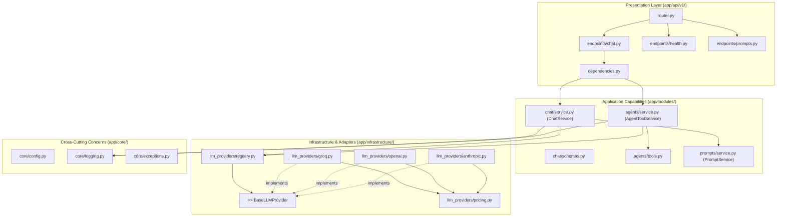
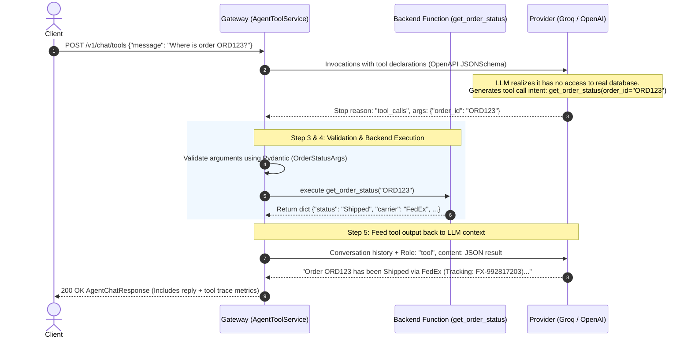

# Comprehensive Architecture, Learning & Implementation Guide

This guide documents every architectural transition, design pattern, engineering decision, and feature implemented in the **FDE Sprint LLM Gateway**. It is structured as an educational reference covering Clean Architecture, Server-Sent Events (SSE) streaming, autonomous tool calling, structured sentiment extraction, prompt engineering, and API reliability.

---

## Table of Contents
1. [The Big Picture: From Spaghetti to Clean Architecture](#1-the-big-picture-from-spaghetti-to-clean-architecture)
2. [Conversational Chat vs. Real-Time Streaming](#2-conversational-chat-vs-real-time-streaming)
3. [Autonomous Tool Calling (Function Calling) Engine](#3-autonomous-tool-calling-function-calling-engine)
4. [Structured Sentiment & Ticket Analysis](#4-structured-sentiment--ticket-analysis)
5. [Prompt Engineering Masterclass & Versioned Library](#5-prompt-engineering-masterclass--versioned-library)
6. [API Reliability, Error Normalization & Security](#6-api-reliability-error-normalization--security)
7. [Observability, Token Accounting & Cost Engine](#7-observability-token-accounting--cost-engine)
8. [Hands-On Verification Cheat Sheet](#8-hands-on-verification-cheat-sheet)

---

## 1. The Big Picture: From Spaghetti to Clean Architecture

### The Problem with Flat / Naive Gateways
In initial or naive backend implementations, everything is tangled together:
- Route handlers directly import third-party SDKs (`import openai`, `import anthropic`, `import groq`).
- Hardcoded prompt strings sit inside service functions.
- If OpenAI changes an SDK parameter, route handlers break.
- Unit testing requires spinning up mock HTTP servers or monkeypatching vendor internals.

### The Clean Architecture Solution
We reorganized the codebase into four strictly bounded layers, adhering to the **Dependency Inversion Principle**:



### Layer Responsibilities & Rules
1. **`app/api/v1/` (Presentation):**
   - *Owns:* HTTP request parsing, Pydantic input validation, status codes, response framing.
   - *Rule:* **Zero** vendor SDK imports, zero prompt strings, zero business decisions.
2. **`app/modules/` (Application Capabilities):**
   - *Owns:* Orchestrating use cases (`chat/`, `prompts/`, `agents/`).
   - *Rule:* Depends on **abstractions** (`BaseLLMProvider`), never on concrete SDK instances.
3. **`app/infrastructure/` (Adapters):**
   - *Owns:* Translating domain commands into external vendor SDK calls (AsyncOpenAI, AsyncGroq, AsyncAnthropic). Handles pricing logic and API key resolution.
   - *Rule:* If we add a new provider (e.g., Mistral or Bedrock), we only add an adapter here. No module or presentation code changes!
4. **`app/core/` (Cross-Cutting Concerns):**
   - *Owns:* Environment variables (`config.py`), structured logging (`logging.py`), centralized exception handling and secret scrubbing (`exceptions.py`).

---

## 2. Conversational Chat vs. Real-Time Streaming

### Why We Separated `/v1/chat` and `/v1/chat/stream`
Previously, `/chat` tried to handle both buffered JSON and streaming via a boolean flag `"stream": true/false`. While viable programmatically, it created issues in OpenAPI documentation:
- Swagger UI displayed `"stream": false` even on streaming examples.
- Swagger UI's web client buffers the entire response in memory before displaying it, making streaming appear broken.

By creating distinct endpoints:
- **`POST /v1/chat`**: Dedicated to pure, conversational AI interactions using the default system prompt. Returns a clean JSON `ChatResponse`.
- **`POST /v1/chat/stream`**: Dedicated to real-time token streaming. Does not require a boolean flag in the request body. Returns `text/event-stream`.

### How Streaming Works Under the Hood (Server-Sent Events)
When a client requests streaming, the HTTP connection is maintained as an open, persistent socket:

```text
Client                                  Gateway (/v1/chat/stream)                      Groq / OpenAI API
  |                                                |                                           |
  |--- POST /v1/chat/stream ---------------------->|                                           |
  |                                                |--- Async Streaming Call ----------------->|
  |<-- HTTP 200 OK (text/event-stream) ------------|                                           |
  |    (Connection: keep-alive)                    |                                           |
  |                                                |<-- Chunk: "The " -------------------------|
  |<-- data: {"content": "The ", "is_complete": false} -|                                      |
  |                                                |<-- Chunk: "API " -------------------------|
  |<-- data: {"content": "API ", "is_complete": false} -|                                      |
  |                                                |<-- Stream Complete -----------------------|
  |<-- data: {"content": "", "is_complete": true} -|                                           |
  |<-- data: [DONE] -------------------------------|                                           |
```

### Why Swagger UI Buffers vs. Terminal Streaming
- **Swagger UI:** Executes `fetch()` without a streaming reader. It collects the entire payload and renders it only after `data: [DONE]` is received.
- **Terminal Client (`scripts/stream_client.py`):** Uses an HTTP stream reader that immediately pipes each incoming token to standard output using `sys.stdout.write(chunk)` and `sys.stdout.flush()`.
- **`curl.exe -N`:** The `-N` (`--no-buffer`) flag disables operating system stream buffering, outputting data lines the exact millisecond the TCP packet arrives.

---

## 3. Autonomous Tool Calling (Function Calling) Engine

### What Tool Calling Actually Is
A common misconception is that the LLM executes code inside its own runtime. **It does not.**
An LLM is purely a next-token prediction engine. In tool calling:
1. The backend informs the LLM about available tools via JSON Schema.
2. The LLM detects missing information, halts text generation, and outputs structured JSON requesting a tool execution.
3. The backend executes the Python function securely, returns the result to the LLM, and the LLM synthesizes the final response.

### The 5-Step Agent Loop Explained



### Argument Validation with Pydantic
In `app/modules/agents/tools.py`:
```python
class OrderStatusArgs(BaseModel):
    order_id: str = Field(..., min_length=3, max_length=50, description="Order identifier, e.g. ORD123")
```
When the LLM outputs JSON arguments, the gateway parses them:
```python
validated_args = OrderStatusArgs.model_validate_json(raw_arguments)
```
If the LLM provides invalid arguments (e.g. an empty string or malformed type), Pydantic catches it before any backend function runs, preventing SQL injection, key errors, or crashes.

---

## 4. Structured Sentiment & Ticket Analysis

### Why Normal Chat Should Not Do Sentiment Analysis
Standard conversation requires helpful, free-flowing language. Forcing a chat endpoint to output JSON breaks conversational interfaces. Conversely, business automation (routing support tickets, flagging churn risk) requires strict, machine-readable JSON.

We decoupled this into **`POST /v1/chat/sentiment`**:
- **Input:** Raw customer text.
- **System Prompt:** `customer_support/v2.txt` (forces classification into rigid categories and JSON schema).
- **Output:** Fully validated Pydantic model (`SentimentAnalysisResponse`).

### Sanitizing LLM Output
LLMs occasionally wrap JSON responses in Markdown code fences (````json { ... } ````). Our service sanitizes this using regex before deserializing:
```python
fence_match = re.search(r"```(?:json)?\s*(\{.*?\})\s*```", raw_text, re.DOTALL)
if fence_match:
    cleaned_text = fence_match.group(1).strip()
parsed = json.loads(cleaned_text)
```
This guarantees that clients receive a typed JSON object rather than an escaped string.

---

## 5. Prompt Engineering Masterclass & Versioned Library

### Where Prompts Live
All prompts are stored as plain text files in `app/modules/prompts/templates/`:
```text
templates/
├── default.txt                     # General AI conversational assistant
├── agent_order_support.txt          # Tool-calling agent persona
└── customer_support/
    ├── v1.txt                      # Baseline basic prompt
    ├── v2.txt                      # Structured instruction + schema constraint
    └── v3.txt                      # Few-shot exemplars + edge-case guidance
```

### The Three Customer Support Prompts Compared

| Metric / Aspect | V1 (Basic) | V2 (Detailed + Schema) | V3 (Few-Shot Exemplars) |
|---|---|---|---|
| **Instruction Style** | 3-line loose instruction | Step-by-step procedure + explicit categories | V2 rules + 3 input/output few-shot exemplars |
| **Output Format** | Unstructured prose or pseudo-JSON | Raw JSON object | Raw JSON object |
| **Classification Drift** | High (invents new categories) | Low (constrained to 6 categories) | Zero (anchored by few-shot demonstrations) |
| **Entity Extraction** | Often misses order IDs or dates | Explicitly extracts declared identifiers | Consistent extraction across all entities |
| **Input Token Cost** | Very low (~40 tokens) | Moderate (~580 tokens) | Higher (~1,100 tokens) |
| **Ideal Use Case** | Quick prototyping / simple queries | Production automation with cost constraints | Critical compliance & deterministic parsing |

### The Prompt Inspection API
You can inspect available prompts directly through the API:
- **`GET /v1/prompts`**: Returns a catalog of available categories and versions.
- **`GET /v1/prompts/{category}/{version}`** (or shortcut **`GET /v1/prompts/{version}`**): Reads the actual written text directly from disk and returns it in a `content` field.

`PromptService` caches loaded templates in memory, avoiding disk I/O on repeated calls.

---

## 6. API Reliability, Error Normalization & Security

### Status Code Mapping Matrix
Raw vendor SDK exceptions are intercepted and translated into standardized HTTP status codes:

| Upstream Failure | Upstream Exception | Gateway Status Code | Client Payload |
|---|---|---|---|
| Invalid parameters / JSON | `BadRequestError` | **400 Bad Request** | `{"error": "llm_provider_error", "detail": "..."}` |
| Missing / Invalid API Key | `AuthenticationError` | **401 Unauthorized** | Redacted error (no raw API key leaked) |
| Rate Limit Reached | `RateLimitError` | **429 Too Many Requests** | Upstream rate limit detail + backoff advice |
| Model Overloaded | `InternalServerError` / `OverloadedError` | **503 Service Unavailable** | Unified provider error |
| Request Timeout | `APITimeoutError` | **504 Gateway Timeout** | Standardized timeout detail |

### Automated Secret Redaction
If an upstream SDK includes an API key in an error traceback or string message, the gateway intercepts it via regex before emitting responses or log entries:
```python
REDACTION_PATTERNS = [
    re.compile(r"sk-[a-zA-Z0-9_\-]{20,}"),
    re.compile(r"gsk_[a-zA-Z0-9_\-]{20,}"),
    re.compile(r"sk-ant-[a-zA-Z0-9_\-]{20,}"),
    re.compile(r"Bearer\s+[a-zA-Z0-9_\-\.]{20,}"),
]
```
Secrets are replaced with `[REDACTED_API_KEY]`, preventing credential leakage in production logs or client error envelopes.

---

## 7. Observability, Token Accounting & Cost Engine

Every LLM request (standard, streaming, or tool calling) records metrics into `logs/app.log`:
- **Provider & Model** (e.g. `groq`, `openai/gpt-oss-120b`).
- **Token Counts** (Prompt tokens + Completion tokens).
- **Latency** (Roundtrip execution time in milliseconds).
- **Estimated Cost (USD)**: Calculated based on token rates defined in `app/infrastructure/llm_providers/pricing.py`.

### Token Pricing Catalog (per 1M tokens)
- **Groq (`openai/gpt-oss-120b`):** \$0.15 Input / \$0.60 Output
- **OpenAI (`gpt-4o-mini`):** \$0.15 Input / \$0.60 Output
- **Anthropic (`claude-3-5-haiku`):** \$0.80 Input / \$4.00 Output

### Example Log Entry (`logs/app.log`)
```json
{
  "timestamp": "2026-11-19T13:45:12.842Z",
  "level": "INFO",
  "event": "LLM_CALL",
  "provider": "groq",
  "model": "openai/gpt-oss-120b",
  "input_tokens": 583,
  "output_tokens": 78,
  "latency_ms": 1535.14,
  "estimated_cost_usd": 0.00029595,
  "status": "success"
}
```

---

## 8. Hands-On Verification Cheat Sheet

Run these commands from PowerShell in `d:\FDE_Training\week1`:

### 1. Test Suite (98 Automated Tests)
```powershell
uv run test
```

### 2. Live Terminal Streaming (Word-by-Word Typing)
```powershell
python scripts/stream_client.py "Explain quantum computing in 3 sentences."
```

### 3. Raw SSE Stream via `curl.exe`
```powershell
curl.exe -N -s -X POST http://127.0.0.1:8000/v1/chat/stream `
  -H "Content-Type: application/json" `
  -d '{"message": "Count from 1 to 5.", "provider": "groq"}'
```

### 4. Conversational Chat Completion
```powershell
curl.exe -s -X POST http://127.0.0.1:8000/v1/chat `
  -H "Content-Type: application/json" `
  -d '{"message": "What is Dependency Inversion in one sentence?", "provider": "groq"}'
```

### 5. Structured Sentiment & Ticket Analysis
```powershell
curl.exe -s -X POST http://127.0.0.1:8000/v1/chat/sentiment `
  -H "Content-Type: application/json" `
  -d '{"text": "My order arrived completely broken and late! Give me my money back.", "provider": "groq"}'
```

### 6. Autonomous Tool Calling (Order Lookup)
```powershell
curl.exe -s -X POST http://127.0.0.1:8000/v1/chat/tools `
  -H "Content-Type: application/json" `
  -d '{"message": "What is the status of my order ORD123?", "provider": "groq"}'
```

### 7. Fetch Raw Prompt Template Content via API
```powershell
curl.exe -s http://127.0.0.1:8000/v1/prompts/customer_support/v2
```

### 8. Interactive Swagger UI
Open your browser at:
```text
http://127.0.0.1:8000/docs
```
Every endpoint includes interactive, pre-populated JSON examples ready for execution.
