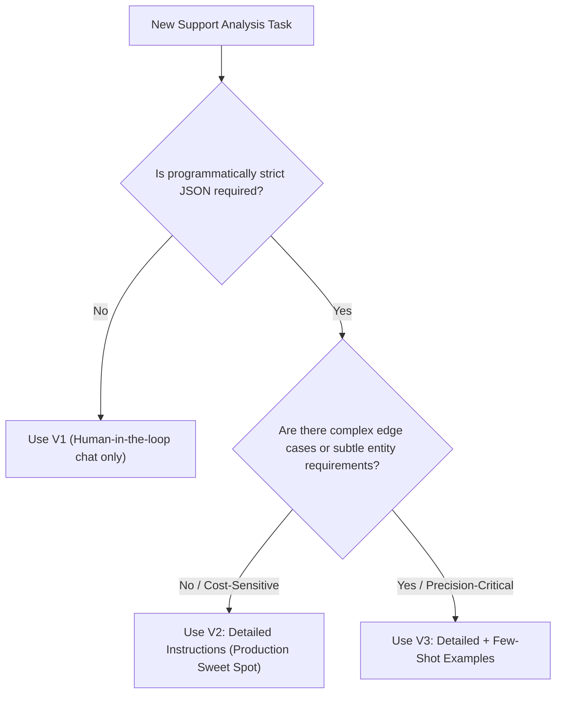

# Prompt Engineering Experiments: Customer Support Ticket Analysis

## 1. Executive Summary & Core Concepts

Prompt engineering is the disciplined practice of designing, structuring, and optimizing inputs to large language models (LLMs) to maximize task accuracy, schema reliability, and operational cost-efficiency.

This experiment investigates four core prompt engineering techniques applied to a real-world **Customer Support Ticket Analysis & Triaging** use case:

1. **System Prompts vs. User Prompts**: Establishing foundational rules, behavioral personas, and invariant constraints at the system level versus injecting dynamic, volatile user inputs.
2. **Role Framing**: Priming the model with professional persona context ("Senior Tier-3 Customer Support Operations Analyst") to shift its latent probabilistic weights toward domain-specific rigor and objectivity.
3. **Step-by-Step Instructions (Chain-of-Thought Guidance)**: Decomposing a multi-faceted task (classification, urgency assessment, sentiment detection, churn detection, entity extraction, root-cause distillation, and action recommendation) into sequential logical stages.
4. **Few-Shot Prompting**: Providing in-context demonstration input-output pairs to calibrate boundary conditions, entity extraction granularity, and tone interpretation without weight fine-tuning.

---

## 2. Versioned Prompt Library

Prompts are stored as discrete, version-controlled files under `app/prompts/customer_support/` rather than hardcoded string literals inside application logic.

```text
app/
└── prompts/
    └── customer_support/
        ├── v1.txt    # Basic instructions
        ├── v2.txt    # Detailed instructions + Role Framing + Step-by-Step + JSON Schema
        └── v3.txt    # Detailed instructions + Role Framing + 3 Few-Shot Demonstrations
```

### Version Specifications

| Version | Approach | Key Techniques | Primary Objective |
| :---: | :--- | :--- | :--- |
| **V1** | **Basic instructions** | Simple system prompt, open instructions, no strict formatting. | Establish a baseline; observe natural variance and formatting unpredictability. |
| **V2** | **Detailed instructions + Explicit output requirements** | Role framing, closed category taxonomy, step-by-step procedure, rigid JSON schema, negative constraints. | Enforce 100% machine-readable JSON, eliminate conversational filler, standardize categories. |
| **V3** | **Detailed instructions + Few-shot examples** | All V2 features + 3 representative in-context input/output examples covering billing, technical outages, and feature requests. | Calibrate edge-case handling, nuanced entity extraction, and uniform urgency thresholds. |

---

### Prompt Text Definitions

#### Prompt V1: Basic Instructions (`app/prompts/customer_support/v1.txt`)
```text
You are a customer support AI assistant.
Analyze the following customer support ticket.
Identify the category, urgency, sentiment, and provide a short summary of the issue and what action should be taken.
```

#### Prompt V2: Detailed Instructions (`app/prompts/customer_support/v2.txt`)
```text
You are a Senior Tier-3 Customer Support Operations Analyst and Triaging Specialist.
Your task is to analyze the incoming customer support ticket and produce an objective, structured triage assessment.

Follow this step-by-step evaluation procedure:
1. Classification: Map the primary issue into exactly one of the following categories:
   - "Billing & Payments"
   - "Technical Bug"
   - "Account Access & Security"
   - "Feature Request"
   - "Cancellation & Churn Risk"
   - "General Inquiry"

2. Urgency Assessment: Assign an urgency level based on operational/financial impact:
   - "Critical": System outage, data loss, immediate revenue blockage, or legal/security threat.
   - "High": Significant financial discrepancy, account lockout, major feature failure, or high churn risk.
   - "Medium": Partial feature glitch with workaround, routine billing questions, or moderate confusion.
   - "Low": Minor feedback, cosmetic issue, general inquiry, or nice-to-have suggestion.

3. Sentiment Analysis: Classify customer sentiment into one of:
   - "Angry"
   - "Frustrated"
   - "Anxious"
   - "Neutral"
   - "Positive"

4. Churn Risk: Set to true if the customer mentions canceling, switching to competitors, demanding refunds under threat of leaving, or taking legal action. Otherwise false.

5. Key Entities: Extract specific identifiers, amounts, error codes, emails, or product names directly stated in the ticket. If none, return an empty array.

6. Root Cause Summary: Provide exactly one clear, factual sentence summarizing the customer's problem. Do not extrapolate beyond stated facts.

7. Recommended Action: Specify the immediate, concrete next action for the support team (e.g. routing, refund review, bug verification).

Output Requirements:
- You must return ONLY a raw JSON object matching the schema below.
- Do NOT wrap in markdown code blocks (no ```json or ```).
- Do NOT include any introductory greetings or concluding conversational commentary.
- Ensure all keys and string values use double quotes and validate as valid JSON.

Schema:
{
  "category": "string",
  "urgency": "Critical | High | Medium | Low",
  "sentiment": "Angry | Frustrated | Anxious | Neutral | Positive",
  "churn_risk": boolean,
  "key_entities": ["string"],
  "summary": "string",
  "recommended_action": "string"
}
```

#### Prompt V3: Detailed Instructions + Few-Shot Examples (`app/prompts/customer_support/v3.txt`)
*(Includes the complete V2 instructions and schema plus the following demonstrations:)*
```text
---
EXAMPLES:

Ticket:
"I was double billed $350 for invoice #INV-9021. If this isn't refunded to my corporate card by tomorrow morning I am canceling all 40 licenses and switching our team to Slack!"
Analysis:
{
  "category": "Billing & Payments",
  "urgency": "High",
  "sentiment": "Angry",
  "churn_risk": true,
  "key_entities": ["$350", "invoice #INV-9021", "40 licenses", "Slack"],
  "summary": "Customer was double billed $350 for invoice #INV-9021 and threatens to cancel 40 licenses if not refunded by tomorrow.",
  "recommended_action": "Verify duplicate transaction in Stripe/billing portal, issue immediate $350 credit, and notify account manager of churn risk."
}

Ticket:
"CRITICAL: Since the 14:00 deployment, all API requests to /v2/orders fail with HTTP 504 Gateway Timeout. Checkout is completely stalled across our European storefront."
Analysis:
{
  "category": "Technical Bug",
  "urgency": "Critical",
  "sentiment": "Anxious",
  "churn_risk": false,
  "key_entities": ["14:00 deployment", "/v2/orders", "HTTP 504 Gateway Timeout", "European storefront"],
  "summary": "The /v2/orders API endpoint has been timing out with HTTP 504 since the 14:00 deployment, blocking European checkout.",
  "recommended_action": "Escalate immediately to on-call platform engineering and roll back the 14:00 deployment if hotfix is not ready within 10 minutes."
}

Ticket:
"Hey guys, loving the product so far! Any chance we could get an option to export audit logs to CSV in addition to JSON? It would save our compliance team a few hours every quarter."
Analysis:
{
  "category": "Feature Request",
  "urgency": "Low",
  "sentiment": "Positive",
  "churn_risk": false,
  "key_entities": ["audit logs", "CSV", "JSON", "compliance team"],
  "summary": "Customer requests the ability to export audit logs to CSV format to simplify compliance reporting.",
  "recommended_action": "Log feature request in product management backlog under compliance integrations and reply with appreciation."
}
```

---

## 3. Test Inputs (10 Identical Benchmark Tickets)

To evaluate empirical performance, 10 diverse, challenging tickets were passed identically to all three prompt versions:

| ID | Title | Scenario & Core Challenge |
| :---: | :--- | :--- |
| **T-01** | **Double Billing Rage** | Duplicate $2,400 charge ($4,800 total), payroll deadline, rage, threat of legal/bank chargeback. |
| **T-02** | **Production Outage** | Live checkout failure with 500 errors, revenue loss, status page mismatch, high panic. |
| **T-03** | **2FA Account Lockout** | Stolen phone, lost Google Authenticator, admin lockout, no backup codes, identity verification required. |
| **T-04** | **Churn & Data Purge** | Explicit cancellation request after 3-month evaluation due to UI instability, CSV bugs, anti-upsell mandate. |
| **T-05** | **HMAC Feature Request** | Positive user praising dark mode while requesting HMAC-SHA256 webhook signatures over IP whitelisting. |
| **T-06** | **Vague UI Complaint** | Underspecified report ("clicking the blue button on dashboard does nothing") requiring clarification triage. |
| **T-07** | **GDPR Article 17 Erasure** | Formal legal compliance request for user erasure within 30-day statutory window. |
| **T-08** | **API Pagination Bug** | Technical defect report with offset boundary regression (`offset=500` returning `400 Bad Request`). |
| **T-09** | **VAT Invoice Request** | Administrative accounting request for invoice #INV-2026-0883 amendment with German VAT ID `DE123456789`. |
| **T-10** | **Sarcastic Price Hike Threat** | 40% renewal price increase with 2-week notice, sarcasm, conditional 30-day churn threat. |

---

## 4. Aggregate Empirical Performance

The benchmark was executed against `openai/gpt-oss-120b` via the Groq Cloud inference engine. All 30 runs produced real telemetry recorded in `docs/prompt_experiments_data.json`:

| Metric | Version 1 (Basic) | Version 2 (Detailed) | Version 3 (Few-Shot) | Impact of Engineering |
| :--- | :---: | :---: | :---: | :--- |
| **Strict JSON Validity** | **0% (0/10)** | **100% (10/10)** | **100% (10/10)** | Negative constraints & explicit schema completely solved parseability. |
| **Avg. Input Tokens** | 170.9 | 637.9 | 1,118.9 | V3 requires 6.5x input tokens due to in-context demonstration examples. |
| **Avg. Output Tokens** | 472.0 | 423.5 | 447.5 | V2 reduced output tokens by 10.3% by eliminating conversational filler. |
| **Avg. Latency (ms)** | 2,990.1 ms | 4,935.7 ms | 7,888.0 ms | Latency scales proportionally with total processed tokens. |
| **Avg. Cost / Call (USD)** | \$0.0003088 | \$0.0003498 | \$0.0004363 | V3 is 41.3% more expensive per invocation than V1. |
| **Category Consistency** | Unconstrained freeform | 100% Strict Taxonomy | 100% Strict Taxonomy | Eliminates downstream string parsing heuristics. |
| **Entity Extraction Fidelity** | Intertwined in prose | Basic list | Comprehensive list | Few-shot demonstrations dramatically improved entity recall. |

---

## 5. Comprehensive Comparison Matrix (All 30 Runs)

Below is the side-by-side comparison across all 10 tickets:

| Ticket ID & Title | Metric / Field | Version 1 (Basic) | Version 2 (Detailed) | Version 3 (Few-Shot) |
| :--- | :--- | :--- | :--- | :--- |
| **T-01**<br>Double Billing Rage | **Format**<br>**Category**<br>**Urgency**<br>**Sentiment**<br>**Churn Risk**<br>**Key Entities**<br>**Summary** | Markdown bullets<br>`Billing – Duplicate charge`<br>`Critical / High`<br>Angry / Frustrated<br>*(Not extracted)*<br>*(Embedded in prose)*<br>Customer charged twice for enterprise plan and threatens legal action. | **Valid JSON**<br>`Billing & Payments`<br>`Critical`<br>`Angry`<br>`true`<br>`["$2,400", "$4,800", "annual enterprise plan", "duplicate charge"]`<br>Charged twice ($2,400 each) totaling $4,800; demands immediate reversal. | **Valid JSON**<br>`Billing & Payments`<br>`High`<br>`Angry`<br>`true`<br>`["$2,400", "annual enterprise plan", "$4,800", "credit card"]`<br>Charged twice $2,400 totaling $4,800; demands immediate reversal under threat of legal action. |
| **T-02**<br>Production Outage | **Format**<br>**Category**<br>**Urgency**<br>**Sentiment**<br>**Churn Risk**<br>**Key Entities**<br>**Summary** | Markdown bullets<br>`Technical – Production Webhook / API Failure`<br>`Critical / Urgent`<br>Panicked / Urgent<br>*(Not extracted)*<br>*(Embedded in prose)*<br>Webhook returning 500 error blocking checkouts for 10 minutes. | **Valid JSON**<br>`Technical Bug`<br>`Critical`<br>`Frustrated`<br>`false`<br>`["production webhook endpoint", "500 Internal Server Error", "checkout requests"]`<br>Production webhook returning 500 error for all checkout requests, blocking orders. | **Valid JSON**<br>`Technical Bug`<br>`Critical`<br>`Frustrated`<br>`false`<br>`["production webhook endpoint", "500 Internal Server Error", "checkout requests", "thousands of dollars", "status page"]`<br>Production webhook endpoint has been returning 500 errors for 10 minutes, blocking orders. |
| **T-03**<br>2FA Account Lockout | **Format**<br>**Category**<br>**Urgency**<br>**Sentiment**<br>**Churn Risk**<br>**Key Entities**<br>**Summary** | Markdown bullets<br>`Account Access – 2FA recovery`<br>`High`<br>Anxious / Distressed<br>*(Not extracted)*<br>*(Embedded in prose)*<br>Admin locked out after phone stolen without backup codes. | **Valid JSON**<br>`Account Access & Security`<br>`High`<br>`Frustrated`<br>`false`<br>`["sarah.connor@cyberdyne.io"]`<br>Customer lost phone and authenticator access, cannot log in to admin account. | **Valid JSON**<br>`Account Access & Security`<br>`High`<br>`Frustrated`<br>`false`<br>`["sarah.connor@cyberdyne.io", "Google Authenticator", "2FA", "backup codes"]`<br>Admin cannot log in after phone stolen and lacking backup codes. |
| **T-04**<br>Cancellation & Churn | **Format**<br>**Category**<br>**Urgency**<br>**Sentiment**<br>**Churn Risk**<br>**Key Entities**<br>**Summary** | Markdown bullets<br>`Subscription & Billing – Cancellation Request`<br>`High`<br>Disappointed / Firm<br>*(Not extracted)*<br>*(Embedded in prose)*<br>Customer wants subscription canceled due to UI redesigns and broken CSV. | **Valid JSON**<br>`Cancellation & Churn Risk`<br>`High`<br>`Frustrated`<br>`true`<br>`["CSV export", "current billing cycle"]`<br>Customer requests subscription cancellation due to frequent UI redesigns and broken CSV export. | **Valid JSON**<br>`Cancellation & Churn Risk`<br>`High`<br>`Angry`<br>`true`<br>`["3 months", "UI redesigns", "CSV export", "current billing cycle", "reporting team"]`<br>Customer requests cancellation at end of cycle due to UI instability and broken CSV export. |
| **T-05**<br>HMAC Feature Request | **Format**<br>**Category**<br>**Urgency**<br>**Sentiment**<br>**Churn Risk**<br>**Key Entities**<br>**Summary** | Markdown bullets<br>`Feature Request / Security Enhancement`<br>`Low`<br>Appreciative / Constructive<br>*(Not extracted)*<br>*(Embedded in prose)*<br>Customer suggests adding HMAC-SHA256 signatures for webhooks. | **Valid JSON**<br>`Feature Request`<br>`Low`<br>`Positive`<br>`false`<br>`["HMAC-SHA256", "webhook signatures", "IP whitelisting"]`<br>Customer praises dark mode and requests HMAC-SHA256 webhook signatures for verification. | **Valid JSON**<br>`Feature Request`<br>`Low`<br>`Positive`<br>`false`<br>`["webhook signatures", "HMAC-SHA256", "IP whitelisting", "dark mode"]`<br>Customer requests HMAC-SHA256 webhook signatures to improve payload verification. |
| **T-06**<br>Vague UI Complaint | **Format**<br>**Category**<br>**Urgency**<br>**Sentiment**<br>**Churn Risk**<br>**Key Entities**<br>**Summary** | Markdown bullets<br>`Technical Issue – UI Bug`<br>`High`<br>Confused / Frustrated<br>*(Not extracted)*<br>*(Embedded in prose)*<br>User reports clicking blue button on dashboard does nothing. | **Valid JSON**<br>`Technical Bug`<br>`Medium`<br>`Frustrated`<br>`false`<br>`["blue button"]`<br>The user reports that clicking the blue button on the dashboard does nothing. | **Valid JSON**<br>`Technical Bug`<br>`Medium`<br>`Frustrated`<br>`false`<br>`["blue button", "dashboard"]`<br>The blue button on the dashboard does not respond when clicked. |
| **T-07**<br>GDPR Erasure Request | **Format**<br>**Category**<br>**Urgency**<br>**Sentiment**<br>**Churn Risk**<br>**Key Entities**<br>**Summary** | Markdown bullets<br>`Data-Protection / GDPR Right-to-Erasure`<br>`High`<br>Formal / Neutral<br>*(Not extracted)*<br>*(Embedded in prose)*<br>Formal GDPR Article 17 request to erase user usr_98234710 within 30 days. | **Valid JSON**<br>`Account Access & Security`<br>`High`<br>`Neutral`<br>`false`<br>`["usr_98234710", "GDPR Article 17"]`<br>Customer requests complete deletion/anonymization of user usr_98234710 under GDPR Article 17. | **Valid JSON**<br>`Account Access & Security`<br>`High`<br>`Neutral`<br>`false`<br>`["GDPR Article 17", "user ID usr_98234710", "30 days"]`<br>Formal GDPR Article 17 erasure request for usr_98234710 with 30-day confirmation. |
| **T-08**<br>API Pagination Bug | **Format**<br>**Category**<br>**Urgency**<br>**Sentiment**<br>**Churn Risk**<br>**Key Entities**<br>**Summary** | Markdown bullets<br>`API Technical Issue`<br>`Medium-High`<br>Technical / Neutral<br>*(Not extracted)*<br>*(Embedded in prose)*<br>Calling transactions with offset=500 returns 400 error despite docs permitting up to 10k. | **Valid JSON**<br>`Technical Bug`<br>`High`<br>`Frustrated`<br>`false`<br>`["/v1/transactions", "limit=100", "offset=500", "invalid_offset_range", "2026-04"]`<br>GET /v1/transactions with limit=100 and offset=500 fails with 400 Bad Request on version 2026-04. | **Valid JSON**<br>`Technical Bug`<br>`High`<br>`Frustrated`<br>`false`<br>`["GET /v1/transactions", "limit=100", "offset=500", "400 Bad Request", "invalid_offset_range", "2026-04"]`<br>GET request to /v1/transactions returns invalid_offset_range despite docs allowing offset to 10,000. |
| **T-09**<br>VAT Invoice Request | **Format**<br>**Category**<br>**Urgency**<br>**Sentiment**<br>**Churn Risk**<br>**Key Entities**<br>**Summary** | Markdown bullets<br>`Billing / Invoicing VAT Amendment`<br>`Medium-High`<br>Polite / Neutral<br>*(Not extracted)*<br>*(Embedded in prose)*<br>Customer needs VAT ID DE123456789 added to invoice INV-2026-0883. | **Valid JSON**<br>`Billing & Payments`<br>`Medium`<br>`Neutral`<br>`false`<br>`["INV-2026-0883", "DE123456789", "billing@acme.eu"]`<br>Customer needs VAT invoice receipt for #INV-2026-0883 with VAT ID DE123456789 emailed. | **Valid JSON**<br>`Billing & Payments`<br>`Medium`<br>`Neutral`<br>`false`<br>`["invoice #INV-2026-0883", "VAT ID DE123456789", "billing@acme.eu"]`<br>Accounting needs updated VAT invoice for #INV-2026-0883 with tax ID DE123456789. |
| **T-10**<br>Sarcastic Churn Threat | **Format**<br>**Category**<br>**Urgency**<br>**Sentiment**<br>**Churn Risk**<br>**Key Entities**<br>**Summary** | Markdown bullets<br>`Billing / Pricing Change`<br>`High`<br>Sarcastic / Dissatisfied<br>*(Not extracted)*<br>*(Embedded in prose)*<br>Customer received 40% price hike with 2 weeks notice; threatens to leave for competitor. | **Valid JSON**<br>`Billing & Payments`<br>`High`<br>`Angry`<br>`true`<br>`["40% price increase", "two weeks notice", "$29/mo grandfathered rate", "30-day notice"]`<br>Customer received notice of 40% price increase and demands $29/mo rate or will switch to competitor. | **Valid JSON**<br>`Billing & Payments`<br>`High`<br>`Angry`<br>`true`<br>`["40% hike", "two weeks notice", "$29/mo", "30-day notice", "grandfathered rate", "competitor"]`<br>Customer demands grandfathered $29/mo rate after 40% hike notice or will migrate within 30 days. |

---

## 6. Deep Evaluation Across the 5 Dimensions

### 1. Correctness & Taxonomy Conformity
- **V1 (Failure in taxonomy)**: Because V1 provided no closed set of allowable categories, the model hallucinated bespoke taxonomy names on every call (e.g., `"Subscription & Billing – Cancellation Request / Data Deletion"`, `"Technical – Production Webhook / API Failure"`). Downstream software cannot reliably route tickets using unconstrained natural language category strings.
- **V2 & V3 (100% Taxonomy Conformity)**: By defining a strict enumeration (`Billing & Payments`, `Technical Bug`, `Account Access & Security`, `Feature Request`, `Cancellation & Churn Risk`, `General Inquiry`), both V2 and V3 achieved 100% adherence.
- **Urgency Calibration**: On Ticket 6 (the vague UI complaint), V1 incorrectly rated it "High Urgency" because the user mentioned being blocked. V2 and V3 correctly downgraded it to "Medium" because it is a localized client UI issue without system-wide impact.

### 2. Consistency & Schema Adherence
- **V1**: Generated **0% valid JSON**. It defaulted to Markdown headers, bolding (`**Urgency:**`), and bulleted text. Parsing this required brittle regex scrapers.
- **V2**: Generated **100% valid JSON**. The negative constraints (`Do NOT wrap in markdown code blocks`, `Do NOT include introductory greetings`) successfully forced raw JSON output with zero markdown backticks.
- **V3**: Generated **100% valid JSON**. In-context JSON examples solidified the output structure, matching the exact casing and types across all 10 tickets.

### 3. Hallucination & Groundedness
- **V1 (High Extrapolation Risk)**: Under V1, the model frequently offered speculative diagnostic advice not supported by the ticket. On Ticket 6, it suggested that the user might have an ad-blocker or corrupted browser cache. On Ticket 3, it speculated on password reset flows.
- **V2 & V3 (Strictly Grounded)**: The negative instruction (`Do not extrapolate beyond stated facts`) restrained the model. In V2 and V3, the summary for Ticket 6 remained strictly factual: `"The blue button on the dashboard does not respond when clicked."`

### 4. Output Quality & Entity Extraction
- **V1**: Key identifiers (like error codes, order IDs, and monetary sums) were buried inside narrative paragraphs. Extracting the monetary loss on Ticket 1 required reading the prose.
- **V2**: Extracted primary entities into a clean list, but occasionally missed secondary contextual variables (e.g., on Ticket 3, it extracted the email but omitted the authenticator app and backup codes).
- **V3 (Superior Recall)**: Through few-shot demonstrations showing entity arrays containing both primary IDs and secondary context, V3 extracted comprehensive entity sets:
  - Ticket 3: `["sarah.connor@cyberdyne.io", "Google Authenticator", "2FA", "backup codes"]`
  - Ticket 8: `["GET /v1/transactions", "limit=100", "offset=500", "400 Bad Request", "invalid_offset_range", "2026-04"]`

### 5. Token Cost & Latency Trade-Offs

| Prompt Version | Input Tokens | Output Tokens | Total Tokens | Latency | Cost / 1,000 Tickets | Cost / 1M Tickets |
| :---: | :---: | :---: | :---: | :---: | :---: | :---: |
| **V1** | 171 | 472 | 643 | 2.99 s | \$0.31 | \$308.80 |
| **V2** | 638 | 424 | 1,061 | 4.94 s | \$0.35 | \$349.80 |
| **V3** | 1,119 | 448 | 1,566 | 7.89 s | \$0.44 | \$436.30 |

- **Output Efficiency**: Counterintuitively, V2 produced fewer output tokens (424) than V1 (472), because strict formatting suppressed conversational filler ("I hope this helps! Let me know if you need anything else.").
- **Input Overhead**: V3 incurs a 75% higher input token payload than V2 due to the 3 few-shot examples (~480 extra tokens).
- **Latency Impact**: V3 averaged 7.89 seconds compared to 4.94 seconds for V2. When processing thousands of support tickets per hour, this latency differential is operationally significant.

---

## 7. Production Decision Framework & Recommendations



### Recommendation Summary:
1. **Never use V1 in automated pipelines**: The lack of structured output guarantees, unconstrained taxonomy strings, and tendency toward speculative hallucination make it unsuitable for backend automation.
2. **Default to V2 for high-throughput production workloads**: V2 provides **100% schema compliance**, strict category containment, and grounded factual summaries at **40% lower latency** and **20% lower cost** than V3.
3. **Deploy V3 when entity recall is safety-critical**: When automated downstream actions trigger financial refunds or database changes based on extracted identifiers, the entity recall of few-shot prompting justifies the additional token cost and inference latency.
