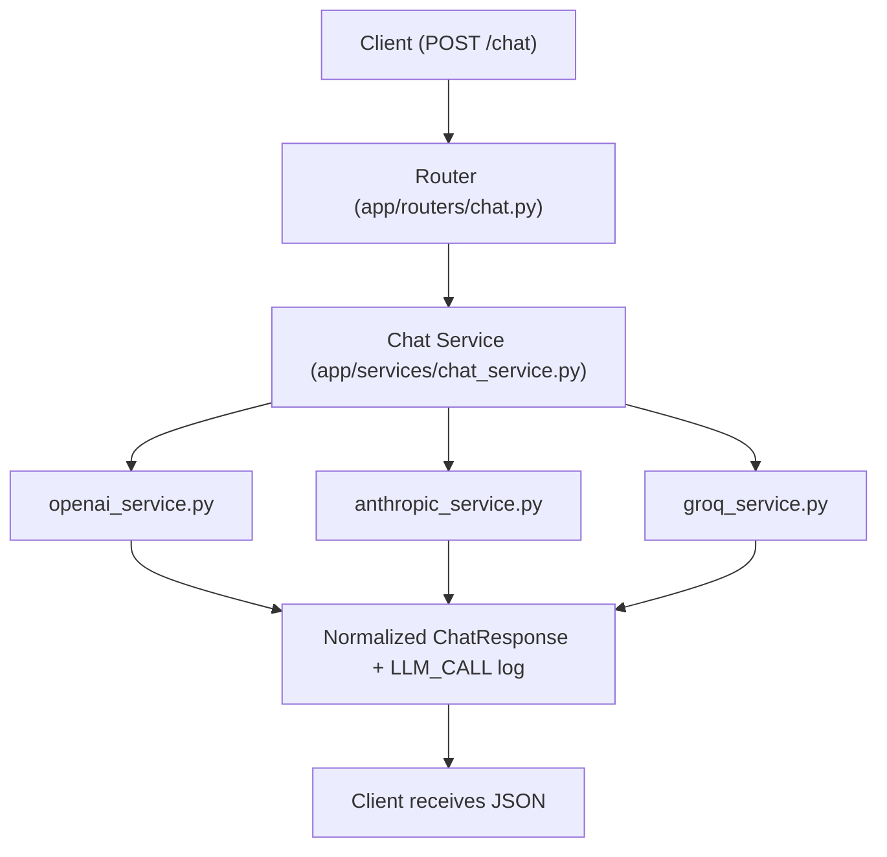

# LLM Provider Comparison — OpenAI vs. Anthropic vs. Groq

Engineering comparison of the three LLM providers integrated into the **FDE Sprint LLM Gateway** (`app/services/`), covering SDK ergonomics, pricing, context limits, rate limits, data policies, live benchmarks, and integration trade-offs.

---

## 1. Core Provider Comparison Matrix

| Criteria | OpenAI | Anthropic | Groq |
| :--- | :--- | :--- | :--- |
| **SDK** | `openai` (`AsyncOpenAI`, `>=3.52.0`) | `anthropic` (`AsyncAnthropic`, `>=2.9.0`) | `groq` (`AsyncGroq`, `>=1.7.0`) |
| **API style** | Responses API *(recommended by OpenAI)* / Chat Completions API *(currently used in `openai_service.py`)* | Messages API (`client.messages.create`) | OpenAI-compatible Chat Completions API (`client.chat.completions.create`) |
| **Authentication** | API key (`OPENAI_API_KEY`, `Authorization: Bearer`) | API key (`ANTHROPIC_API_KEY`, `x-api-key` header) | API key (`GROQ_API_KEY`, `Authorization: Bearer`) |
| **Model selected** | `gpt-6-luna` *(default in `config.py`; `gpt-4o-mini` also configured)* | `claude-haiku-5-5` *(default in `config.py`; `claude-haiku-4-5` also configured)* | `openai/gpt-oss-120b` *(active in `.env`; fallback `llama-3.3-70b-versatile`)* |
| **Input token price** | $0.10 / 1M (`gpt-6-luna`)<br>$0.15 / 1M (`gpt-4o-mini`) | $0.10 / 1M (`claude-haiku-5-5`, <100K prompt)<br>$1.00 / 1M (`claude-haiku-4-5`) | $0.15 / 1M (`openai/gpt-oss-120b`, $0.075 cached)<br>$0.05 / 1M (`llama-3.1-8b-instant`)<br>*(Free developer tier available)* |
| **Output token price** | $0.50 / 1M (`gpt-6-luna`)<br>$0.60 / 1M (`gpt-4o-mini`) | $0.50 / 1M (`claude-haiku-5-5`)<br>$5.00 / 1M (`claude-haiku-4-5`) | $0.60 / 1M (`openai/gpt-oss-120b`)<br>$0.08 / 1M (`llama-3.1-8b-instant`)<br>*(Free developer tier available)* |
| **Context window** | 128K input / 16K output (`gpt-4o-mini`); GPT-6 efficient reasoning tier for `gpt-6-luna` | **1,000,000** input / 128K output (`claude-haiku-5-5`)<br>200K input / 64K output (`claude-haiku-4-5`) | **131,072** (128K) input / 65,536 max output (`openai/gpt-oss-120b`) |
| **Rate limits** | Tier-based (`Build` / Tier 1 unlocks at $5 spend): ~500 RPM & ~200K TPM baseline for `gpt-4o-mini`; stricter initial TPM for reasoning models (`gpt-6-luna`) | Tier-based (`Start` / Tier 1): up to ~1,000 RPM with token-bucket ITPM/OTPM; cached input tokens do not count against ITPM | **Verified live (Free Tier headers):** `1,000` req/day, `8,000` TPM (org-wide). Paid Developer tier scales up to ~1,000 RPM / 250K TPM |
| **Data policies** | **No training** on API data by default. Up to 30-day abuse-monitoring retention; Zero Data Retention (ZDR) available via enterprise approval | **No training** on commercial API data by default. Up to 30-day retention for abuse monitoring (longer if flagged); ZDR available for eligible enterprise orgs | **No training** on customer data. No default inference storage (transient LPU execution); up to 30-day logs only for critical debugging/abuse; ZDR configurable in console |
| **Measured latency** | *Pending live API key test* *(typical: ~800–1,800 ms for short prompts)* | *Pending live API key test* *(typical: ~700–1,500 ms for short prompts)* | **604–722 ms** end-to-end *(live tested via `POST /chat` against Groq `bom` region: 604.45 ms @ 95→40 tok; 721.52 ms @ 160→33 tok)* |
| **Response quality** | *Pending live side-by-side eval* — strong general-purpose coding, JSON adherence, and adjustable reasoning effort (`gpt-6-luna`) | *Pending live side-by-side eval* — strong instruction following, natural tone, and long-context synthesis | **Evaluated live** — crisp, well-structured, concise reasoning output from `openai/gpt-oss-120b` (120B MoE reasoning model) at ~500 tok/s |
| **Integration difficulty** | **Low** — clean async context manager (`AsyncOpenAI`), optional `max_tokens`, and inline `system` role message. Main nuance: deciding between legacy Chat Completions vs. newer Responses API | **Low–Medium** — slightly different API contract: `max_tokens` is strictly required, `system` is a top-level argument rather than a message, and replies return typed content blocks (`block.type == "text"`) | **Very Low** — official `AsyncGroq` SDK mirrors OpenAI's exact `chat.completions.create` interface and Stainless exception hierarchy, making drop-in normalization trivial |

---

## 2. Configured Model Pricing & Cost Projections

All rates below match `MODEL_PRICING_PER_1M` in [`app/core/pricing.py`](../app/core/pricing.py).

| Provider | Model | Input ($ / 1M) | Output ($ / 1M) | Cost per 1 Request *(1K in / 500 out)* | Cost per 10,000 Requests *(1K in / 500 out)* |
| :--- | :--- | :---: | :---: | :---: | :---: |
| **OpenAI** | `gpt-6-luna` | $0.10 | $0.50 | $0.000350 | $3.50 |
| **OpenAI** | `gpt-4o-mini` | $0.15 | $0.60 | $0.000450 | $4.50 |
| **Anthropic** | `claude-haiku-5-5` | $0.10 | $0.50 | $0.000350 | $3.50 |
| **Anthropic** | `claude-haiku-4-5` | $1.00 | $5.00 | $0.003500 | $35.00 |
| **Groq** | `llama-3.1-8b-instant` | $0.05 | $0.08 | $0.000090 | $0.90 |
| **Groq** | `openai/gpt-oss-20b` | $0.075 | $0.30 | $0.000225 | $2.25 |
| **Groq** | `openai/gpt-oss-120b` | $0.15 | $0.60 | $0.000450 | $4.50 |
| **Groq** | `llama-3.3-70b-versatile` | $0.59 | $0.79 | $0.000985 | $9.85 |

> **Observability Safeguard:** If a model configured in `.env` is missing from `MODEL_PRICING_PER_1M`, `calculate_cost_usd()` emits a `WARNING` log and returns `0.0` rather than failing the user's request.

---

## 3. SDK & API Ergonomics Observed During Integration

Implementing all three services side by side (`openai_service.py`, `anthropic_service.py`, `groq_service.py`) surfaced concrete differences that justify having a unified gateway layer:

| Integration Detail | OpenAI (`openai_service.py`) | Anthropic (`anthropic_service.py`) | Groq (`groq_service.py`) |
| :--- | :--- | :--- | :--- |
| **Async Client** | `AsyncOpenAI(api_key, timeout)` | `AsyncAnthropic(api_key, timeout)` | `AsyncGroq(api_key, timeout)` |
| **System Prompt Passing** | Inside `messages`: `{"role": "system", "content": SYSTEM_PROMPT}` | Top-level param: `system=SYSTEM_PROMPT` | Inside `messages`: `{"role": "system", "content": SYSTEM_PROMPT}` |
| **`max_tokens` Parameter** | Optional | **Mandatory** (`max_tokens=1024`) | Optional |
| **Extracting Text Reply** | `response.choices[0].message.content` | `"\n".join(b.text for b in response.content if b.type == "text")` | `response.choices[0].message.content` |
| **Empty Response Edge Cases** | Must check both `not response.choices` and empty `message.content` | Must filter for `type == "text"` blocks (tool/thinking blocks may exist) | Same as OpenAI |
| **Usage Token Fields** | `usage.prompt_tokens` / `usage.completion_tokens` *(usage may be `None`)* | `usage.input_tokens` / `usage.output_tokens` | `usage.prompt_tokens` / `usage.completion_tokens` |
| **Exception Hierarchy** | Stainless (`APIError`, `APITimeoutError`, `RateLimitError`, `AuthenticationError`, etc.) | Identical Stainless exception names | Identical Stainless exception names |

### Key Architectural Takeaway
Because all three SDKs are generated with Stainless, their exception hierarchies share identical class names (`APITimeoutError`, `RateLimitError`, `AuthenticationError`, `PermissionDeniedError`, `BadRequestError`, `InternalServerError`, `APIConnectionError`). This allowed a single centralized mapper — `LLMProviderError.from_upstream()` in [`app/core/exceptions.py`](../app/core/exceptions.py) — to translate upstream failures deliberately across all three providers without duplicating `except` branches in each service.

---

## 4. Live Benchmark & Rate-Limit Observations

Captured directly from `logs/app.log` during live local testing of the gateway:

### Groq (`openai/gpt-oss-120b` — Free Tier)
- **Edge POP served:** `x-groq-region: bom` (Mumbai)
- **Live Free-Tier Rate-Limit Headers Observed:**
  - `x-ratelimit-limit-requests: 1000` (requests/day)
  - `x-ratelimit-limit-tokens: 8000` (tokens/minute — *note: because LPU inference runs at ~500 tok/s, you will hit the 8K TPM ceiling well before the 1,000 RPD cap during bursts*)
- **Live Request Runs:**

| Run | Model | Input Tokens | Output Tokens | Upstream Latency | End-to-End HTTP Latency | Est. List Cost (USD) |
| :---: | :--- | :---: | :---: | :---: | :---: | :---: |
| 1 | `openai/gpt-oss-120b` | 95 | 40 | `604.45 ms` | ~`606 ms` | `$0.00003825` |
| 2 | `openai/gpt-oss-120b` | 160 | 33 | `721.52 ms` | `723.56 ms` | `$0.00004380` |

> Gateway overhead (`api.access` minus `llm_observability` latency) was just **~2.04 ms** end-to-end.

### How to Run Your Own Side-by-Side Latency & Quality Test
Once you add `OPENAI_API_KEY` and `ANTHROPIC_API_KEY` to `.env`, start the server with `uv run dev` and send the exact same prompt to all three providers:

```powershell
foreach ($p in @("openai", "anthropic", "groq")) {
    $body = @{ message = "Explain idempotency in REST APIs in 2 concise sentences."; provider = $p } | ConvertTo-Json
    Invoke-RestMethod -Uri "http://127.0.0.1:8000/chat" -Method Post -ContentType "application/json" -Body $body
}
```

Inspect `logs/app.log` afterward to compare `latency_ms`, `input_tokens`, `output_tokens`, and `estimated_cost_usd` side by side.

---

## 5. Gateway Architecture & Error Contract



### Deliberate HTTP Status Code Mapping

| Failure Scenario | Upstream Signal | Gateway HTTP Status | Error Code |
| :--- | :--- | :---: | :--- |
| Invalid client request body | FastAPI / Pydantic validation | `422` | FastAPI validation error |
| Missing provider API key in `.env` | `settings.<provider>_api_key is None` | `503` | `llm_provider_error` |
| Invalid / expired upstream key | `AuthenticationError` (`401`) | `401` | `llm_provider_error` |
| Restricted model / org permissions | `PermissionDeniedError` (`403`) | `403` | `llm_provider_error` |
| Invalid params / context length exceeded | `BadRequestError` (`400`) | `400` | `llm_provider_error` |
| Upstream RPM / TPM quota hit | `RateLimitError` (`429`) | `429` | `llm_provider_error` |
| Upstream request exceeded `REQUEST_TIMEOUT` | `APITimeoutError` / `TimeoutError` | `504` | `llm_provider_error` |
| Upstream 5xx, connection drop, or empty reply | `InternalServerError` / `APIConnectionError` | `502` | `llm_provider_error` |
| Unexpected internal bug (e.g., `TypeError`) | Unhandled `Exception` | `500` | `internal_error` |

---

## 6. Data Privacy & Compliance Summary

| Policy Aspect | OpenAI API | Anthropic API | Groq API |
| :--- | :--- | :--- | :--- |
| **Trains on API data by default?** | No (opt-in only) | No (commercial terms isolate API data) | No |
| **Default retention window** | Up to 30 days (abuse monitoring) | Up to 30 days (abuse monitoring; extended if flagged) | None by default (transient); up to 30 days only for critical error/abuse investigation |
| **Zero Data Retention (ZDR)** | Enterprise approval required | Enterprise approval required | Configurable in Groq Console |
| **Enterprise Compliance (SOC 2 / DPA / BAA)** | Available (Enterprise) | Available (Commercial DPA / HIPAA options) | Available (Enterprise) |

---

## 7. Recommendation: When to Choose Which Provider

1. **Choose Groq (`openai/gpt-oss-120b` or `llama-3.1-8b-instant`)** when:
   - You want **zero-cost local development** via the free developer tier.
   - **Sub-second latency** and high tokens/second matter (real-time chat, voice agents, autocomplete, fast routing/classification).
   - *Watch out for:* strict free-tier TPM ceilings (`8,000` TPM observed on `openai/gpt-oss-120b`) — upgrade to paid tier or add retry/fallback before production traffic.
2. **Choose OpenAI (`gpt-6-luna` / `gpt-4o-mini`)** when:
   - You need a reliable **all-rounder** with mature tool-calling, structured JSON outputs, and high Tier 1 token throughput (`~200K` TPM on `gpt-4o-mini`).
   - *Next improvement:* consider migrating `openai_service.py` from Chat Completions to OpenAI's newer **Responses API** (`client.responses.create`) when adding multi-turn state or built-in tools.
3. **Choose Anthropic (`claude-haiku-5-5` / `claude-haiku-4-5`)** when:
   - You need **massive context windows** (up to **1M tokens** on `claude-haiku-5-5`) with prompt caching that doesn't count against input token rate limits.
   - Instruction-following precision, synthesis quality, and nuanced technical writing are top priorities.
