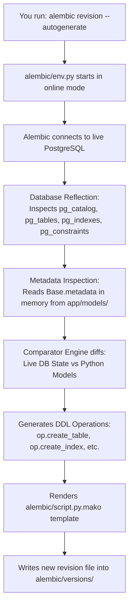
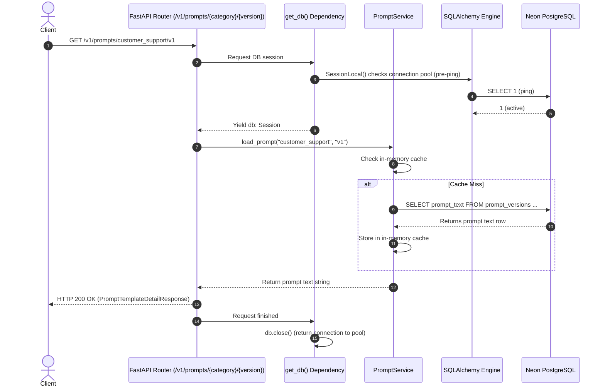

# Database Architecture, SQLAlchemy, & Alembic Migrations Deep-Dive

This document is a comprehensive study guide explaining how relational database persistence, SQLAlchemy 2.0 ORM, and Alembic database migrations function together in this project.

---

## Table of Contents
1. [Core Mental Model & Architecture](#1-core-mental-model--architecture)
2. [Packages Installed & What Each One Does](#2-packages-installed--what-each-one-does)
3. [Project Directory Architecture](#3-project-directory-architecture)
   - [`app/db/` (Engine, Session, Base)](#appdb-engine-session-base)
   - [`app/models/` (Database Entities)](#appmodels-database-entities)
   - [`app/schemas/` (Pydantic vs SQLAlchemy)](#appschemas-pydantic-vs-sqlalchemy)
   - [`app/services/` (Data Access & Business Logic)](#appservices-data-access--business-logic)
4. [Alembic Internals: How Migrations Actually Work](#4-alembic-internals-how-migrations-actually-work)
   - [`alembic.ini` (Configuration Blueprint)](#alembicini-configuration-blueprint)
   - [`alembic/env.py` (The Migration Orchestrator)](#alembicenvpy-the-migration-orchestrator)
   - [`alembic/script.py.mako` (The Template Generator)](#alembicscriptpymako-the-template-generator)
   - [`alembic/versions/` (The Migration DAG)](#alembicversions-the-migration-dag)
   - [The `alembic_version` Database Table](#the-alembic_version-database-table)
5. [The Autogenerate Pipeline Under the Hood](#5-the-autogenerate-pipeline-under-the-hood)
6. [Complete Command Cheat Sheet & Workflows](#6-complete-command-cheat-sheet--workflows)
7. [Neon Serverless PostgreSQL Nuances](#7-neon-serverless-postgresql-nuances)
8. [End-to-End Request Lifecycle](#8-end-to-end-request-lifecycle)

---

## 1. Core Mental Model & Architecture

In modern backend engineering, your database and your application code exist in two separate worlds:

```
[ Python Code (FastAPI) ]                       [ PostgreSQL Database (Neon) ]
      │                                                      │
   Models (Python classes)       <-- DDL / Schema Drift --> Tables (SQL tables)
      │                                                      │
  SQLAlchemy ORM                                       Physical Columns, Indexes
      │                                                      │
   Alembic  ────────────────────── Version Control ─────────► alembic_version table
```

* **SQLAlchemy** acts as the bridge between Python objects and SQL queries (translating Python method calls into `SELECT`, `INSERT`, `UPDATE`, `DELETE`).
* **Alembic** acts like **Git for your database schema**, tracking every structural change (creating tables, altering columns, adding indexes) across environments.
* **psycopg** is the low-level network driver converting Python data types into wire-level PostgreSQL protocol packets over TLS/TCP.

---

## 2. Packages Installed & What Each One Does

### 1. `sqlalchemy` (v2.1+)
* **What it is:** The premier Object-Relational Mapper (ORM) and SQL toolkit for Python.
* **Why we use it:**
  * **Declarative Mapping:** Define relational tables as Python classes with strict type annotations (`Mapped[str]`, `mapped_column(String(100))`).
  * **Query Builder:** Write idiomatic, injection-safe SQL queries using Python syntax (`select(PromptVersion).where(...)`).
  * **Session & Identity Map:** Tracks loaded objects in memory, handles transactional boundaries (`commit()`, `rollback()`), and guarantees that only one copy of a database row exists in a given session.
  * **Connection Pooling:** Manages a pool of reusable TCP connections to PostgreSQL to avoid the latency of opening a new socket connection on every HTTP request.

### 2. `alembic` (v1.20+)
* **What it is:** The official database migration framework for SQLAlchemy, authored by the creator of SQLAlchemy (Mike Bayer).
* **Why we use it:**
  * Databases don't automatically update their tables when you edit Python models.
  * Alembic inspects your SQLAlchemy models, inspects the actual live PostgreSQL database, computes the **diff**, and creates a version-controlled migration file containing reversible Python instructions (`upgrade()` and `downgrade()`).

### 3. `psycopg[binary]` & `psycopg2-binary`
* **What they are:** Python database adapters (DBAPIs) for PostgreSQL written in C/Rust that speak the PostgreSQL wire protocol.
* **Why both / why psycopg 3?**
  * SQLAlchemy 2.0+ default dialect for `postgresql://` is **psycopg 3** (`import psycopg`). If `psycopg` is missing, it raises an error.
  * `psycopg-binary` contains pre-compiled native binaries, meaning you do not need C compilers or PostgreSQL client development headers installed on your machine.
  * Supports modern PostgreSQL features, SSL connection modes, and native JSON parsing.

### 4. `pgvector` (v0.5+)
* **What it is:** The official Python support library for the PostgreSQL `vector` extension.
* **Why we installed it:**
  * Neon natively supports `vector` (version 0.8.7+).
  * In the initial migration, we executed `CREATE EXTENSION IF NOT EXISTS vector;`.
  * When we later add embeddings (for document search, RAG, semantic retrieval), PostgreSQL can store vectors as native columns (`Vector(1536)`) and run approximate nearest neighbor search via HNSW and IVFFlat indexes.

---

## 3. Project Directory Architecture

```text
week1/
├── app/
│   ├── db/
│   │   ├── base.py         <-- Base declarative class for all models
│   │   ├── session.py      <-- Engine, Sessionmaker, get_db dependency
│   │   └── __init__.py     <-- Clean re-exports
│   ├── models/
│   │   ├── prompt.py       <-- SQLAlchemy ORM table definitions
│   │   └── __init__.py
│   ├── schemas/
│   │   ├── prompt.py       <-- Pydantic API validation models
│   │   └── __init__.py
│   └── services/
│       ├── prompt_service.py <-- Database operations & caching
│       └── __init__.py
├── alembic/
│   ├── env.py              <-- Migration execution logic
│   ├── script.py.mako      <-- Migration script template
│   └── versions/           <-- Versioned migration files
└── alembic.ini             <-- Alembic configuration file
```

---

### `app/db/` (Engine, Session, Base)

#### `app/db/base.py`
```python
from sqlalchemy.orm import DeclarativeBase

class Base(DeclarativeBase):
    """Base declarative class for all SQLAlchemy database models."""
    pass

import app.models  # Registers all models onto Base.metadata
```
* **Purpose:** Every SQLAlchemy model inherits from `Base`.
* `Base.metadata` is a central catalog that holds descriptions of every table, column, constraint, and index declared in Python.
* Importing `app.models` ensures that when Alembic imports `Base`, all defined models are already registered in `Base.metadata`.

#### `app/db/session.py`
```python
from sqlalchemy import create_engine
from sqlalchemy.orm import Session, sessionmaker
from app.core.config import settings

engine = create_engine(
    settings.db_url,
    pool_pre_ping=True,  # Tests connection validity before handing it out
    echo=False,
)

SessionLocal = sessionmaker(autocommit=False, autoflush=False, bind=engine)

def get_db():
    db = SessionLocal()
    try:
        yield db
    except Exception:
        db.rollback()
        raise
    finally:
        db.close()
```
* **Engine:** The central factory holding connection pools and DBAPI dialect configurations.
* **`pool_pre_ping=True`:** Essential for serverless databases like Neon. If Neon puts an idle compute instance to sleep or drops a socket, `pool_pre_ping` emits a fast `SELECT 1` ping. If the connection is dead, it reconnects automatically instead of raising an unhandled `500 OperationalError`.
* **`SessionLocal`:** A factory producing new `Session` objects.
* **`get_db()`:** A FastAPI dependency. It opens a database session when an HTTP request starts, passes it to your endpoint, rolls back if an unhandled error occurs, and guarantees `db.close()` when the request finishes.

---

### `app/models/` (Database Entities)

Defined in [app/models/prompt.py](file:///d:/FDE_Training/week1/app/models/prompt.py):

* **`PromptCategory` (Table: `prompt_categories`)**:
  Represents functional namespaces (`customer_support`, `general`, `code_generation`).
  Has a 1-to-many relationship with `PromptVersion`.
* **`PromptVersion` (Table: `prompt_versions`)**:
  Stores the exact prompt string, metadata, version label (`v1`, `v2`), format variables, and active flag.

Key SQLAlchemy 2.0 constructs used:
```python
class PromptVersion(Base):
    __tablename__ = "prompt_versions"
    __table_args__ = (
        UniqueConstraint("category_id", "version", name="uq_prompt_category_version"),
    )

    id: Mapped[int] = mapped_column(Integer, primary_key=True, autoincrement=True)
    category_id: Mapped[int] = mapped_column(Integer, ForeignKey("prompt_categories.id", ondelete="CASCADE"), nullable=False, index=True)
    version: Mapped[str] = mapped_column(String(50), nullable=False, index=True)
    prompt_text: Mapped[str] = mapped_column(Text, nullable=False)
    variables: Mapped[Optional[Any]] = mapped_column(JSON, nullable=True)
    is_active: Mapped[bool] = mapped_column(Boolean, default=True, nullable=False)
    created_at: Mapped[datetime] = mapped_column(DateTime(timezone=True), server_default=func.now(), nullable=False)
```

* **`ForeignKey(..., ondelete="CASCADE")`:** If a category is deleted, all its versioned prompts are cleaned up in PostgreSQL automatically.
* **`UniqueConstraint("category_id", "version")`:** Enforces at the database engine level that you cannot accidentally insert duplicate versions (e.g. two `v1`s under `customer_support`).
* **`server_default=func.now()`:** Tells PostgreSQL to use its native clock (`CURRENT_TIMESTAMP`) rather than relying on application server time.

---

### `app/schemas/` (Pydantic vs SQLAlchemy)

Why both?
* **SQLAlchemy models (`app/models/`):** Define how data is physically laid out in PostgreSQL tables (foreign keys, table constraints, indices).
* **Pydantic schemas (`app/schemas/`):** Define what JSON shapes entering or exiting the HTTP API look like (request body validation, response serialization, field masking).

Using `model_config = ConfigDict(from_attributes=True)` enables Pydantic to read directly from SQLAlchemy ORM instances without manual dictionary translation:
```python
class PromptVersionRead(BaseModel):
    id: int
    category_id: int
    version: str
    prompt_text: str
    is_active: bool
    created_at: datetime

    model_config = ConfigDict(from_attributes=True)
```

---

### `app/services/` (Data Access & Business Logic)

[app/services/prompt_service.py](file:///d:/FDE_Training/week1/app/services/prompt_service.py) provides clean encapsulation:
* The FastAPI endpoints do not write raw SQL or complex joins.
* It exposes domain operations: `load_prompt(category, version)`, `get_system_prompt(name)`, `list_categories()`, `list_versions()`.
* **In-memory Cache:** Keeps resolved prompt strings in `self._cache[f"{category}/{version}"]` so that high-throughput LLM streaming calls never hit the database multiple times for the same static prompt template.

---

## 4. Alembic Internals: How Migrations Actually Work

### `alembic.ini` (Configuration Blueprint)
* Located in the root directory.
* Directs Alembic where its scripts live (`script_location = %(here)s/alembic`).
* Defines logging formats and post-write hooks.
* In our configuration, we intentionally **do not hardcode database credentials** inside `alembic.ini`. Instead, `alembic/env.py` reads `DB_URL` directly from [app/core/config.py](file:///d:/FDE_Training/week1/app/core/config.py) and `.env`.

---

### `alembic/env.py` (The Migration Orchestrator)

`env.py` is executed every time you run an `alembic` command. It is the brain connecting Alembic to your code and your database.

Here is how our [alembic/env.py](file:///d:/FDE_Training/week1/alembic/env.py) operates:

```python
# 1. Provide target_metadata so autogenerate knows our models
target_metadata = Base.metadata

# 2. Get database URL dynamically from environment
def get_url() -> str:
    return settings.db_url or os.getenv("DB_URL")

# 3. Online mode: connect to live database
def run_migrations_online() -> None:
    db_url = get_url()

    # We use NullPool because migrations run once and exit.
    connectable = create_engine(db_url, poolclass=pool.NullPool)

    with connectable.connect() as connection:
        context.configure(
            connection=connection,
            target_metadata=target_metadata,
            compare_type=True,  # Detects if a column type changed (e.g. VARCHAR(50) -> VARCHAR(100))
        )
        with context.begin_transaction():
            context.run_migrations()
```

#### Offline vs. Online Mode:
* **Offline mode (`alembic upgrade head --sql`):** Doesn't connect to PostgreSQL! It outputs raw SQL statements to stdout/file so DBAs can review before applying to production.
* **Online mode (`alembic upgrade head`):** Connects to PostgreSQL, acquires a transaction lock, applies the migration, updates the `alembic_version` table, and commits.

---

### `alembic/script.py.mako` (The Template Generator)

#### What is a `.mako` file?
**Mako** is a fast Python templating engine (created by the author of SQLAlchemy and Alembic). Just like Jinja2 is used to render HTML, Mako is used by Alembic to **generate Python migration files**.

#### How does it work?
When you type:
```powershell
uv run alembic revision --autogenerate -m "create_documents_table"
```
Alembic computes the schema diff, loads [alembic/script.py.mako](file:///d:/FDE_Training/week1/alembic/script.py.mako), injects the diff variables into the template placeholders, and writes out a new `.py` file inside `alembic/versions/`.

Here is the line-by-line breakdown of `script.py.mako`:

```mako
"""${message}

Revision ID: ${up_revision}
Revises: ${down_revision | comma,n}
Create Date: ${create_date}
"""
from typing import Sequence, Union
from alembic import op
import sqlalchemy as sa
${imports if imports else ""}

# revision identifiers, used by Alembic.
revision: str = ${repr(up_revision)}
down_revision: Union[str, Sequence[str], None] = ${repr(down_revision)}
branch_labels: Union[str, Sequence[str], None] = ${repr(branch_labels)}
depends_on: Union[str, Sequence[str], None] = ${repr(depends_on)}


def upgrade() -> None:
    """Upgrade schema."""
    ${upgrades if upgrades else "pass"}


def downgrade() -> None:
    """Downgrade schema."""
    ${downgrades if downgrades else "pass"}
```

#### What each variable represents:
| Mako Variable | What Alembic Injects |
| :--- | :--- |
| `${message}` | The message passed via `-m "create_documents_table"`. |
| `${up_revision}` | A unique 12-character hex ID generated by Alembic (e.g., `7524807c9184`). |
| `${down_revision}` | The revision ID of the previous migration file (forming a linked list). `None` for the first migration. |
| `${create_date}` | UTC timestamp when the revision was generated. |
| `${upgrades}` | Python code containing `op.create_table(...)`, `op.add_column(...)`, etc. |
| `${downgrades}` | Inverse Python code containing `op.drop_table(...)`, `op.drop_column(...)`, etc. |

---

### `alembic/versions/` (The Migration DAG)

Every file in `alembic/versions/` is an immutable step in a Directed Acyclic Graph (DAG) or linked list:

```text
[Migration 1: 7524807c9184]
down_revision = None
upgrade()   -> creates prompt_categories & prompt_versions
downgrade() -> drops prompt_versions & prompt_categories
        ▲
        │
[Migration 2: a1b2c3d4e5f6]
down_revision = "7524807c9184"
upgrade()   -> creates documents table (with vector embedding)
downgrade() -> drops documents table
```

Because each file explicitly states its `down_revision`, Alembic always knows the exact order in which migrations must run.

---

### The `alembic_version` Database Table

How does PostgreSQL know which migrations have been applied?

Alembic automatically creates a 1-row table in your database named `alembic_version`:

```sql
SELECT * FROM alembic_version;
```
```text
 version_num  
──────────────
 7524807c9184
(1 row)
```

When you run `alembic upgrade head`:
1. Alembic checks `alembic_version`.
2. Finds `7524807c9184`.
3. Checks the `alembic/versions/` folder to see if any migration file has `down_revision = "7524807c9184"`.
4. If found, runs that file's `upgrade()` function and updates `version_num` to the new ID.
5. If none found, reports that the schema is already at `head`.

---

## 5. The Autogenerate Pipeline Under the Hood

When you execute `alembic revision --autogenerate -m "..."`:



### What Autogenerate Detects Automatically:
* Table additions and removals.
* Column additions, removals, and nullable alterations.
* Indexes and unique constraints.
* Foreign keys.

### What You Should Verify / Add Manually:
* Database-specific extensions (e.g. `CREATE EXTENSION IF NOT EXISTS vector;`).
* Table or column renames (autogenerate sees a rename as `drop_column` + `add_column`, which would delete existing production data if not converted to `op.alter_column`).
* Data migrations (backfilling rows, data transformations).

---

## 6. Complete Command Cheat Sheet & Workflows

### Standard Developer Workflow

#### Step 1: Make your changes in Python
Edit or create a model in `app/models/` (e.g., add a new table or column).

#### Step 2: Generate the migration script
```powershell
uv run alembic revision --autogenerate -m "add_documents_table"
```
Alembic compares your Python models against PostgreSQL and outputs a new file in `alembic/versions/`.

#### Step 3: Review the generated migration file
Open `alembic/versions/xxxx_add_documents_table.py` and inspect `upgrade()` and `downgrade()` to ensure it matches your intentions.

#### Step 4: Apply the migration
```powershell
uv run alembic upgrade head
```
Executes the DDL against PostgreSQL and advances `alembic_version`.

---

### Command Reference

| Command | What it does | When to use it |
| :--- | :--- | :--- |
| `uv run alembic revision --autogenerate -m "msg"` | Diffs models against DB and generates a migration script. | After changing anything in `app/models/`. |
| `uv run alembic upgrade head` | Runs all unapplied migrations up to the newest. | To apply pending migrations to your database. |
| `uv run alembic upgrade +1` | Runs exactly one pending migration forward. | For step-by-step migration testing. |
| `uv run alembic downgrade -1` | Rolls back the most recent migration. | If a migration failed or needs to be revised. |
| `uv run alembic downgrade base` | Rolls back **all** migrations (empties the schema). | For completely resetting a test database. |
| `uv run alembic current` | Shows the currently applied revision in the DB. | To see what version your database is running. |
| `uv run alembic history --verbose` | Displays the timeline of all migrations in the project. | To inspect the full migration tree and comments. |
| `uv run alembic check` | Verifies if any models have un-migrated changes. | In CI/CD pipelines to prevent uncommitted model drift. |
| `uv run alembic stamp head` | Updates `alembic_version` to head **without running SQL**. | Use with extreme caution: only when tables already exist. |

---

## 7. Neon Serverless PostgreSQL Nuances

Our database is hosted on **Neon** (`ep-small-boat-aov9d0v2-pooler...aws.neon.tech`).

Key characteristics to understand:
1. **Connection Pooling Endpoint:**
   * Notice `-pooler` in the host URL. Neon uses `PgBouncer` in transaction-pooling mode.
   * This is why we use `poolclass=pool.NullPool` in `env.py` during migrations, avoiding session-level lock conflicts with the pooler.
2. **Auto-suspend & `pool_pre_ping`:**
   * Neon automatically suspends compute instances after 5 minutes of inactivity to save compute hours.
   * When an incoming request arrives, Neon wakes the instance in ~500ms.
   * Our `pool_pre_ping=True` in `app/db/session.py` ensures that any stale sockets held by our app are safely discarded and transparently reconnected upon wake-up.
3. **SSL Mode & Channel Binding:**
   * Neon requires `sslmode=require&channel_binding=require` to guarantee encrypted transit and authenticate against SCRAM-SHA-256.

---

## 8. End-to-End Request Lifecycle

Here is the exact lifecycle of an API call fetching a prompt from the database:



This completes the architecture: **clean separation of concerns, transactional safety, version-controlled schema evolution, and zero hardcoded prompts in application code.**
